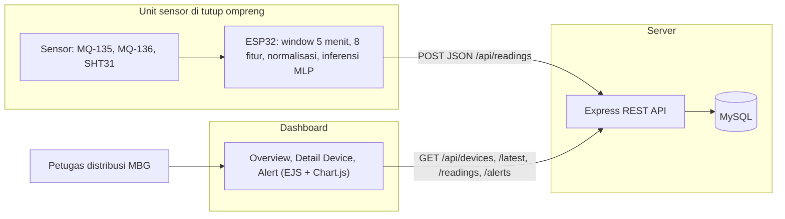
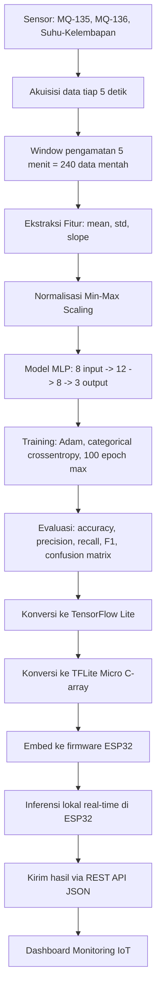
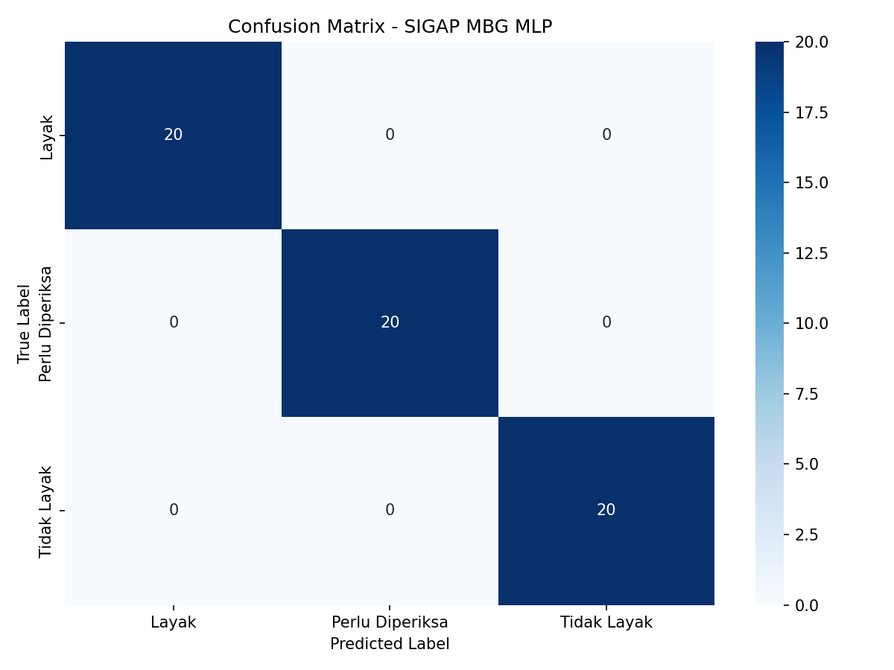
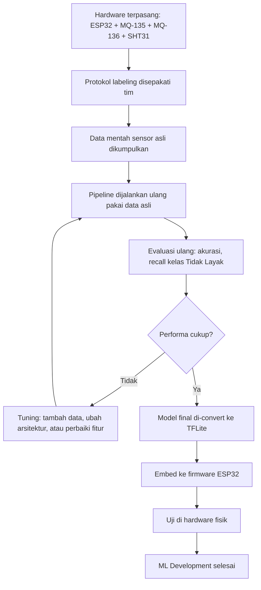
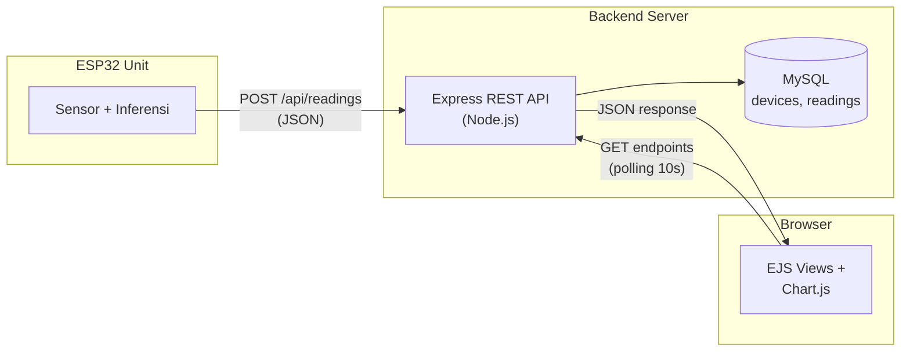
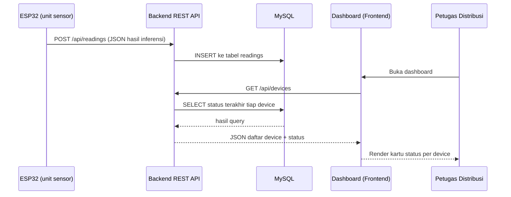

# SIGAP MBG — Smart Lid for Food Freshness Monitoring

SIGAP MBG (Sistem Informasi dan Grading Aman Pangan - Makan Bergizi Gratis) adalah modul sensor pintar yang dipasang di tutup ompreng (wadah makanan) untuk program Makan Bergizi Gratis (MBG). Sistem ini mendeteksi kesegaran makanan secara real-time selama distribusi menggunakan sensor gas (MQ-135, MQ-136) dan sensor suhu-kelembapan (SHT31), lalu mengklasifikasikan kondisi makanan ke dalam 3 kategori: **Layak**, **Perlu Diperiksa**, atau **Tidak Layak**. Klasifikasi dilakukan langsung di perangkat ESP32 menggunakan model Machine Learning (TinyML), dan hasilnya dikirim ke dashboard monitoring berbasis web untuk petugas distribusi.

---

## Status Proyek

| Komponen | Status | Catatan |
|----------|--------|---------|
| **Pipeline ML (Python)** | ✅ Selesai | 7 script training & konversi working, model TFLite ready |
| **Model Performance** | ⚠️ Data Dummy | Akurasi 100% dari data sintetis — **BUKAN performa asli**. Training final menunggu data sensor asli dari tim hardware. |
| **Firmware ESP32** | 🟡 Skeleton | Code lengkap untuk sensor reading & feature extraction. **TFLite inference masih stub** (belum integrasi library). Belum diuji di hardware fisik. |
| **Backend API** | ✅ Selesai | Express REST API, 5 endpoint validated, MySQL schema ready |
| **Frontend Dashboard** | ✅ Selesai | 3 halaman (Overview, Device Detail, Alerts), auto-polling 10 detik, responsive |
| **Data Sensor Asli** | ❌ Belum Ada | **Blocker utama** untuk training final. Tim hardware sedang merakit unit sensor. |
| **Uji Hardware End-to-End** | ❌ Belum | Menunggu hardware fisik selesai + data asli terkumpul |

**Kesimpulan:** Pipeline kode untuk ketiga komponen (ML, firmware, web) sudah dibangun dan tervalidasi secara teknis, tetapi sistem belum diuji dengan data sensor asli maupun hardware fisik. Training model final menunggu pengumpulan dataset dari eksperimen dengan 9 sampel makanan (karbohidrat, protein, buah) yang dipantau dari kondisi segar hingga busuk.

---

## Arsitektur Sistem End-to-End

Diagram berikut menunjukkan alur kerja sistem dari sensor hingga dashboard. **Prediksi dilakukan di ESP32** (edge computing), sehingga sistem tetap berfungsi meski koneksi internet terbatas. Server hanya menyimpan dan menampilkan hasil, tidak melakukan inferensi.



ESP32 membaca sensor setiap 5 detik selama 5 menit (240 data point), mengekstrak 8 fitur statistik, menormalisasi dengan parameter Min-Max dari training, menjalankan model MLP (8→12→8→3), lalu mengirim hasil klasifikasi beserta nilai sensor ke server. Dashboard menampilkan status terkini semua unit secara real-time dengan badge warna (hijau/kuning/merah) sesuai tingkat risiko.

---

## Kerangka Machine Learning

### Pipeline Training

Pipeline ML mengubah data time-series sensor mentah menjadi model TinyML yang dapat berjalan di ESP32 dengan konsumsi daya rendah.



### 8 Fitur Input

Dari 240 data mentah per window (5 menit), sistem mengekstrak 8 fitur statistik yang merepresentasikan pola sensor selama periode pengamatan:

| # | Fitur | Sumber | Deskripsi |
|---|-------|--------|-----------|
| 1 | `mq135_mean` | MQ-135 | Rata-rata konsentrasi gas (NH₃, polutan) |
| 2 | `mq135_std` | MQ-135 | Variabilitas pembacaan (stabilitas) |
| 3 | `mq135_slope` | MQ-135 | Tren kenaikan/penurunan (regresi linear) |
| 4 | `mq136_mean` | MQ-136 | Rata-rata konsentrasi H₂S |
| 5 | `mq136_std` | MQ-136 | Variabilitas pembacaan |
| 6 | `mq136_slope` | MQ-136 | Tren kenaikan/penurunan |
| 7 | `temp_mean` | SHT31 | Rata-rata suhu (°C) |
| 8 | `humidity_mean` | SHT31 | Rata-rata kelembapan (%RH) |

**Slope** (kemiringan) sangat penting karena menangkap tren kenaikan konsentrasi gas — indikator pembusukan yang lebih kuat dibanding nilai rata-rata saja.

### Arsitektur Model

Model MLP (Multi-Layer Perceptron) ringan dengan 239 parameter, dirancang untuk inferensi real-time di ESP32:

```
Input Layer:     8 neuron
Hidden Layer 1:  12 neuron, aktivasi ReLU
Hidden Layer 2:  8 neuron, aktivasi ReLU
Output Layer:    3 neuron, aktivasi Softmax

Total parameter: 239
Ukuran TFLite:   3.07 KB (quantized int8)
```

**Hyperparameter training:**
- Optimizer: Adam (learning rate 0.001)
- Loss: Categorical Crossentropy
- Batch size: 16
- Max epochs: 100, dengan EarlyStopping (patience 15, monitor val_loss)
- Data split: 80% train / 20% test (stratified untuk jaga keseimbangan kelas)

### Evaluasi Model

**⚠️ Catatan Penting:** Metrik di bawah diperoleh dari **data dummy** (sintetis) yang sengaja dibuat mudah dipisahkan antar kelas untuk validasi pipeline. Angka ini **BUKAN indikator performa asli** — akurasi hampir pasti akan turun saat model dilatih ulang dengan data sensor asli yang lebih noisy dan memiliki overlap antar kelas. Ini normal dan sudah diantisipasi.



**Hasil evaluasi (data dummy):**
- Test accuracy: 100% (60/60 sampel)
- Precision: 100% semua kelas
- Recall: 100% semua kelas (termasuk "Tidak Layak" — metrik kritis untuk keamanan pangan)
- F1-score: 100% semua kelas

**Output kelas:**
0. **Layak** — Aman dikonsumsi
1. **Perlu Diperiksa** — Mulai menunjukkan indikasi penurunan mutu, butuh verifikasi manual
2. **Tidak Layak** — Tidak aman dikonsumsi

### Konversi ke TinyML

Model Keras (.h5, 34 KB) → TensorFlow Lite (.tflite, 3 KB) → C array header (model_data.h, 19 KB):

```bash
python src/model/convert_tflite.py
# Output: models/sigap_mbg_mlp.tflite
#         firmware/esp32/model_data.h
```

File `model_data.h` berisi array unsigned char yang di-embed langsung ke firmware ESP32. Quantization (int8) mengurangi ukuran model dari 34 KB menjadi 3 KB tanpa kehilangan akurasi signifikan (pada data dummy).

### Dependency Chain Menuju "ML Selesai"

Diagram berikut menunjukkan langkah-langkah yang harus terjadi sebelum bagian ML dapat disebut selesai secara penuh. **Kode pipeline sudah siap** — yang ditunggu adalah data asli dan validasi hardware.



**Poin penting:** Kode yang sudah ada tidak perlu ditulis ulang — cukup ganti file input dari `data/raw/dummy_sensor_data.csv` ke `data/raw/real_sensor_data.csv` dan jalankan ulang urutan script yang sama.

---

## Kerangka Web Dashboard

### Arsitektur

Dashboard berbasis web tradisional (server-rendered) dengan polling untuk update data. Dipilih karena sederhana, tidak butuh infrastruktur tambahan (websocket server), dan cukup untuk kebutuhan monitoring PKM.



### Tech Stack

- **Backend:** Node.js + Express (REST API)
- **Database:** MySQL 8.0 (relational, mature, sesuai proposal)
- **Frontend:** EJS (server-rendered templates), Vanilla JavaScript, Chart.js
- **Styling:** Custom CSS (responsive, mobile-friendly)
- **Deployment:** Bisa Railway, Render, atau server kampus (free tier cukup untuk demo)

### Skema Database

Tabel `devices` menyimpan informasi unit SIGAP MBG yang terdaftar. Tabel `readings` menyimpan semua hasil pembacaan sensor dan prediksi.

```sql
-- Tabel devices
CREATE TABLE devices (
    id INT AUTO_INCREMENT PRIMARY KEY,
    device_id VARCHAR(50) UNIQUE NOT NULL,
    location_name VARCHAR(150),
    created_at TIMESTAMP DEFAULT CURRENT_TIMESTAMP
);

-- Tabel readings
CREATE TABLE readings (
    id INT AUTO_INCREMENT PRIMARY KEY,
    device_id VARCHAR(50) NOT NULL,
    reading_timestamp DATETIME NOT NULL,
    mq135_mean FLOAT, mq135_std FLOAT, mq135_slope FLOAT,
    mq136_mean FLOAT, mq136_std FLOAT, mq136_slope FLOAT,
    temp_mean FLOAT, humidity_mean FLOAT,
    prediction ENUM('Layak', 'Perlu Diperiksa', 'Tidak Layak') NOT NULL,
    confidence FLOAT,
    created_at TIMESTAMP DEFAULT CURRENT_TIMESTAMP,
    FOREIGN KEY (device_id) REFERENCES devices(device_id)
);
```

Device baru dibuat otomatis saat ESP32 mengirim data untuk pertama kali (`device_id` belum terdaftar), sehingga tidak perlu registrasi manual untuk demo/testing.

### REST API Endpoints

Backend menyediakan 5 endpoint untuk komunikasi ESP32 → server dan dashboard → server:

| Method | Endpoint | Fungsi | Digunakan Oleh |
|--------|----------|--------|----------------|
| POST | `/api/readings` | Terima payload JSON dari ESP32, validasi, simpan ke database | ESP32 firmware |
| GET | `/api/devices` | List semua device dengan status terakhir masing-masing | Dashboard (Overview) |
| GET | `/api/devices/:device_id/latest` | Ambil pembacaan terbaru untuk 1 device | Dashboard (kartu status) |
| GET | `/api/devices/:device_id/readings?limit=100` | Riwayat pembacaan untuk grafik tren | Dashboard (Detail Device) |
| GET | `/api/alerts?status=X&limit=50` | List reading kritis (Perlu Diperiksa / Tidak Layak) | Dashboard (Alerts) |

**Validasi payload POST:**
- Field wajib: `device_id`, `timestamp`, `prediction`
- Enum `prediction` harus salah satu dari: "Layak", "Perlu Diperiksa", "Tidak Layak"
- Sensor values (8 fitur) harus bertipe number
- Timestamp harus format ISO 8601 (e.g., `2026-09-19T10:15:00Z`)
- Response sukses: HTTP 201 Created dengan `{success: true, id: X, device_id: Y, prediction: Z}`
- Response error: HTTP 400 Bad Request atau 500 Internal Error dengan `{error: "message"}`

### Halaman Dashboard

Dashboard terdiri dari 3 halaman utama untuk monitoring status makanan secara real-time:

**1. Overview (`/overview`)**
- Grid card untuk semua device yang terdaftar
- Badge warna per device sesuai status terakhir:
  - 🟢 Hijau → "Layak" (aman dikonsumsi)
  - 🟡 Kuning → "Perlu Diperiksa" (mulai menurun, perlu verifikasi)
  - 🔴 Merah → "Tidak Layak" (tidak aman dikonsumsi)
- Info: lokasi device, confidence score, suhu, kelembapan, waktu update terakhir
- Auto-refresh setiap 10 detik via polling

**2. Detail Device (`/device/:device_id`)**
- Status terkini (latest reading)
- Grafik Chart.js:
  - Gas sensors trend (MQ-135, MQ-136 mean)
  - Temperature & humidity trend (dual Y-axis)
- Tabel riwayat pembacaan (default 100 terakhir)
- Badge warna dinamis sesuai prediction terbaru

**3. Alerts (`/alerts`)**
- List semua kejadian kritis (status "Perlu Diperiksa" dan "Tidak Layak")
- **TIDAK menampilkan** status "Layak" (filter otomatis)
- Filter dropdown: status, limit
- Sort: terbaru dulu (reading_timestamp DESC)
- Icon: ⚠️ kuning untuk "Perlu Diperiksa", 🔴 merah untuk "Tidak Layak"

---

## Alur Distribusi Informasi ke Dashboard

Bagian ini menjelaskan secara detail bagaimana data sensor dari ESP32 sampai ke dashboard yang dilihat petugas distribusi.

### Sequence Diagram



### Contoh Payload JSON dari ESP32

ESP32 mengirim payload JSON berikut setelah menyelesaikan inferensi (setiap 5 menit):

```json
{
  "device_id": "SIGAP-MBG-01",
  "timestamp": "2026-09-19T10:15:00Z",
  "mq135_mean": 245.3,
  "mq135_std": 12.1,
  "mq135_slope": 0.85,
  "mq136_mean": 18.7,
  "mq136_std": 2.3,
  "mq136_slope": 0.12,
  "temp_mean": 29.4,
  "humidity_mean": 68.2,
  "prediction": "Perlu Diperiksa",
  "confidence": 0.87
}
```

### Pemetaan Field Payload → Database

Backend mem-parse payload JSON dan menyimpannya ke tabel `readings` dengan mapping berikut:

| Field JSON | Kolom Database | Tipe | Transformasi |
|------------|----------------|------|--------------|
| `device_id` | `device_id` | VARCHAR(50) | Langsung |
| `timestamp` | `reading_timestamp` | DATETIME | Parse ISO 8601 → MySQL DATETIME |
| `mq135_mean` | `mq135_mean` | FLOAT | Langsung |
| `mq135_std` | `mq135_std` | FLOAT | Langsung |
| `mq135_slope` | `mq135_slope` | FLOAT | Langsung |
| `mq136_mean` | `mq136_mean` | FLOAT | Langsung |
| `mq136_std` | `mq136_std` | FLOAT | Langsung |
| `mq136_slope` | `mq136_slope` | FLOAT | Langsung |
| `temp_mean` | `temp_mean` | FLOAT | Langsung |
| `humidity_mean` | `humidity_mean` | FLOAT | Langsung |
| `prediction` | `prediction` | ENUM | Validasi: harus "Layak" / "Perlu Diperiksa" / "Tidak Layak" |
| `confidence` | `confidence` | FLOAT | Langsung (opsional, boleh NULL) |

**Tidak ada field yang dropped atau diubah tipe** — kompatibilitas 100% antara payload ML dan schema web.

### Langkah-Langkah Proses

1. **ESP32 kirim POST request** ke `/api/readings` dengan payload JSON
2. **Backend validasi payload:**
   - Cek field wajib: `device_id`, `timestamp`, `prediction`
   - Cek enum `prediction` valid
   - Cek tipe data sensor values (harus number)
   - Parse timestamp ISO 8601
3. **Auto-create device** jika `device_id` belum terdaftar:
   - Query: `SELECT device_id FROM devices WHERE device_id = ?`
   - Jika tidak ada: `INSERT INTO devices (device_id, location_name) VALUES (?, NULL)`
4. **Insert reading** ke database:
   - Query: `INSERT INTO readings (...) VALUES (...)`
5. **Response HTTP 201** ke ESP32 dengan `{success: true, id: X}`
6. **Dashboard polling** (setiap 10 detik):
   - Browser fetch `GET /api/devices`
   - Backend query: latest reading per device (JOIN dengan subquery)
   - Response JSON ke browser
7. **Frontend render:**
   - Parse JSON
   - Tentukan badge warna berdasarkan `prediction`:
     - "Layak" → class `status-layak` (background hijau #dcfce7)
     - "Perlu Diperiksa" → class `status-perlu-diperiksa` (background kuning #ffedd5)
     - "Tidak Layak" → class `status-tidak-layak` (background merah #fee2e2)
   - Render device cards dengan badge warna sesuai
   - Update timestamp "last updated"
8. **Repeat polling** setelah 10 detik

**Kode HTTP response:**
- Sukses: `201 Created` (POST), `200 OK` (GET)
- Error validasi: `400 Bad Request`
- Error server: `500 Internal Server Error`
- Device tidak ditemukan: `404 Not Found` (khusus endpoint `/latest`)

---

## Cara Menjalankan

### Machine Learning Pipeline

Dokumentasi lengkap tersedia di [`docs/ML_QUICKSTART.md`](docs/ML_QUICKSTART.md).

**Ringkasan singkat:**

```bash
# 1. Setup environment
python -m venv .venv
source .venv/bin/activate  # Windows: .venv\Scripts\activate
pip install -r requirements.txt

# 2. Generate data dummy (jika belum ada)
python src/data_collection/generate_dummy_data.py

# 3. Jalankan pipeline
python src/feature_extraction/extract_features.py
python src/preprocessing/normalize.py
python src/model/train.py
python src/model/evaluate.py
python src/model/convert_tflite.py

# 4. Verifikasi
python verify_pipeline.py
```

**Output:** Model TFLite di `models/sigap_mbg_mlp.tflite`, C array di `firmware/esp32/model_data.h`.

**Note:** Data dummy (6.56 MB) tidak ikut di repo. Generate ulang dengan script di langkah 2.

### Backend & Dashboard

Dokumentasi lengkap tersedia di [`sigap-mbg-dashboard/README.md`](sigap-mbg-dashboard/README.md).

**Ringkasan singkat:**

```bash
# 1. Setup database
mysql -u root -p < sigap-mbg-dashboard/backend/migrations/init.sql

# 2. Configure environment
cd sigap-mbg-dashboard/backend
cp .env.example .env
# Edit .env: set DB_PASSWORD

# 3. Install dependencies
npm install

# 4. Start server
npm run dev
# atau: npm start (production)

# 5. Buka dashboard
# Browser: http://localhost:3000
```

**Test dengan dummy data:**

```bash
node sigap-mbg-dashboard/backend/test-dummy-data.js
```

Script ini mengirim 3 payload (Layak, Perlu Diperiksa, Tidak Layak) ke endpoint POST untuk validasi integrasi ML ↔ Web.

### Firmware ESP32

Dokumentasi lengkap tersedia di [`firmware/esp32/README.md`](firmware/esp32/README.md).

**Ringkasan singkat:**

```bash
# 1. Install PlatformIO
# https://platformio.org/install

# 2. Edit firmware
cd firmware/esp32
# Edit main.cpp: ganti WIFI_SSID, WIFI_PASSWORD, SERVER_URL

# 3. Build & upload
pio run -t upload

# 4. Monitor serial
pio device monitor
```

**⚠️ Status firmware:** Code lengkap untuk sensor reading & feature extraction, tapi **TFLite inference masih stub**. Perlu integrasi library EloquentTinyML atau TensorFlowLite_ESP32. Belum diuji di hardware fisik.

---

## Struktur Repo

```
├── data/
│   ├── raw/                      # Data sensor mentah (CSV time-series)
│   │   └── .gitkeep              # dummy_sensor_data.csv excluded, generate ulang
│   └── processed/                # Dataset hasil ekstraksi fitur
│       ├── feature_dataset.csv
│       ├── train_normalized.csv
│       └── test_normalized.csv
├── models/
│   ├── sigap_mbg_mlp.h5          # Model Keras (34 KB)
│   ├── sigap_mbg_mlp.tflite      # Model TFLite quantized (3 KB)
│   ├── scaler_params.json        # Min-Max params untuk normalisasi
│   └── confusion_matrix.png      # Visualisasi evaluasi (data dummy)
├── src/
│   ├── data_collection/          # Generator data dummy
│   ├── feature_extraction/       # Windowing + ekstraksi 8 fitur
│   ├── preprocessing/            # Min-Max scaling + train/test split
│   ├── model/                    # Training, evaluasi, konversi TFLite
│   └── utils/                    # Utilities (kosong saat ini)
├── firmware/
│   └── esp32/
│       ├── main.cpp              # Firmware ESP32 lengkap
│       ├── model_data.h          # Model TFLite sebagai C array
│       ├── platformio.ini        # Config PlatformIO
│       └── README.md             # Dokumentasi firmware
├── sigap-mbg-dashboard/
│   ├── backend/
│   │   ├── src/                  # Express app, routes, db connection
│   │   ├── migrations/           # init.sql, test.sql
│   │   ├── test-dummy-data.js    # Script test integrasi ML ↔ Web
│   │   └── package.json
│   └── frontend/
│       ├── views/                # EJS templates (3 halaman)
│       └── public/               # CSS, JavaScript, assets
├── docs/
│   ├── ML_Pipeline_SIGAP_MBG.md              # Spesifikasi teknis ML
│   ├── Web_Dashboard_SIGAP_MBG.md            # Spesifikasi teknis web
│   ├── Status_dan_Langkah_Selanjutnya_ML_SIGAP_MBG.md  # Status & roadmap
│   ├── ML_QUICKSTART.md                      # Quick start ML (README lama)
│   ├── IMPLEMENTATION_CHECKLIST.md           # Checklist ML
│   ├── IMPLEMENTATION_CHECKLIST_Dashboard.md # Checklist dashboard
│   └── VALIDATION_REPORT.md                  # Hasil validasi Tahap 3
├── notebooks/                    # Jupyter notebooks untuk EDA (kosong saat ini)
├── verify_pipeline.py            # Script verifikasi end-to-end ML
├── requirements.txt              # Python dependencies
├── .gitignore
└── README.md                     # Dokumen ini
```

---

## Roadmap / Langkah Selanjutnya

### Prioritas Tinggi (Blocker)

- [ ] **Kumpulkan data sensor asli** dari 9 sampel makanan (karbohidrat, protein, buah)
  - Pantau secara kontinu dari kondisi segar hingga busuk (bukan snapshot tunggal)
  - Tiap sampel dipantau tiap 1-2 jam → menghasilkan puluhan window per sampel
  - Target minimal: 200-300 window total dengan distribusi kelas seimbang
- [ ] **Sepakati protokol labeling** sebelum mulai pengumpulan data
  - Kriteria objektif per kelas (waktu penyimpanan, verifikasi sensorik 2+ orang)
  - Dokumentasi kondisi lingkungan saat pengambilan data
- [ ] **Rakit hardware fisik** (ESP32 + MQ-135 + MQ-136 + SHT31 + powerbank)
- [ ] **Integrasi TFLite Micro** ke firmware ESP32
  - Ganti `runInference()` stub dengan EloquentTinyML atau TensorFlowLite_ESP32
  - Test inferensi dengan data dummy sebelum deploy ke hardware

### Setelah Data Asli Tersedia

- [ ] **Re-train model** dengan data asli (jalankan ulang pipeline)
- [ ] **Evaluasi ulang** — cek recall kelas "Tidak Layak" secara khusus
- [ ] **Tuning** jika performa kurang (tambah data, sesuaikan arsitektur, perbaiki fitur)
- [ ] **Uji end-to-end** dengan hardware fisik: sensor → ESP32 → dashboard
- [ ] **Kalibrasi sensor** MQ-135/MQ-136 ke nilai ppm absolut (opsional, untuk interpretasi)

### Perbaikan & Fitur Tambahan (Opsional)

- [ ] Tambahkan authentication di dashboard (login petugas)
- [ ] Upgrade polling ke websocket untuk update real-time tanpa delay
- [ ] Export data ke CSV/Excel dari dashboard
- [ ] Notifikasi push/email saat ada alert "Tidak Layak"
- [ ] Mobile app (opsional, jika ada kebutuhan monitoring di lapangan)

---

## Catatan & Batasan

### Dataset Dummy

Model saat ini dilatih dengan **data sintetis** yang dibuat untuk validasi pipeline, bukan data sensor asli. Karakteristik data dummy:
- Rentang nilai per kelas sengaja dibuat mudah dipisahkan (no overlap)
- Noise minimal, tidak ada outlier
- Tidak mencerminkan variabilitas dunia nyata (suhu ruangan, jenis makanan, kondisi penyimpanan)

**Akurasi 100% dari data dummy BUKAN indikator performa asli.** Saat model dilatih ulang dengan data sensor asli, akurasi akan turun (target realistis: 80-90%). Ini normal dan sudah diantisipasi dalam desain pipeline.

### Konfigurasi Sensor

Dokumen spesifikasi menyebut sensor suhu-kelembapan **SHT31** (bagian teknis), tetapi bagian lain proposal awal menyebut **SHT21**. Firmware dan kode ML menggunakan **SHT31**. Tim hardware perlu konfirmasi sensor final yang dipakai sebelum hardware assembly.

### Kalibrasi Sensor Gas

MQ-135 dan MQ-136 belum dikalibrasi ke nilai ppm absolut. Sensor membaca raw ADC value (0-1023). Untuk interpretasi hasil yang lebih akurat, sensor perlu dikalibrasi dengan gas standar, tetapi untuk klasifikasi (tujuan proyek ini), kalibrasi tidak wajib — model belajar dari pola raw values.

### Firmware Inference

TFLite inference di firmware masih **stub** (threshold sederhana, bukan model ML). Integrasi TFLite Micro library (EloquentTinyML atau TensorFlowLite_ESP32) diperlukan sebelum firmware dapat berjalan sesuai desain. Stub dipakai untuk validasi alur data (sensor → JSON → server) tanpa menunggu integrasi library.

### Belum Diuji di Hardware

Seluruh sistem (ML, firmware, dashboard) sudah tervalidasi secara teknis dengan data dummy dan test script, tetapi **belum pernah diuji dengan hardware fisik**. Uji hardware menunggu:
1. Hardware unit selesai dirakit
2. Data sensor asli terkumpul
3. Model final di-embed ke firmware

---

## Tim & Lisensi

**Tim PKM-KC SIGAP MBG:**
<!-- TODO: konfirmasi nama lengkap tim sebelum repo public -->
- Fionita Fahra Azzahra
- Aulia Rafi Hermawan
- Muhamad Restu Alvykya

**Kontributor Kode:**
- Machine Learning & Web Dashboard: Mahdi Habibi

**Lisensi:** Proyek PKM-KC 2026

---

## Referensi & Dokumentasi

- **Spesifikasi Teknis:** [`docs/ML_Pipeline_SIGAP_MBG.md`](docs/ML_Pipeline_SIGAP_MBG.md), [`docs/Web_Dashboard_SIGAP_MBG.md`](docs/Web_Dashboard_SIGAP_MBG.md)
- **Status & Roadmap:** [`docs/Status_dan_Langkah_Selanjutnya_ML_SIGAP_MBG.md`](docs/Status_dan_Langkah_Selanjutnya_ML_SIGAP_MBG.md)
- **Quick Start ML:** [`docs/ML_QUICKSTART.md`](docs/ML_QUICKSTART.md)
- **Validation Report:** [`docs/VALIDATION_REPORT.md`](docs/VALIDATION_REPORT.md)
- **Proposal PKM-KC:** (tidak disertakan di repo)
