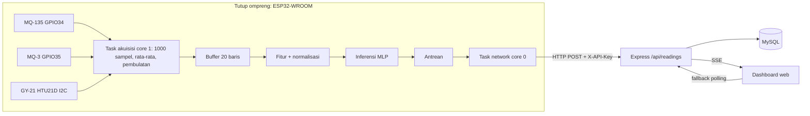

# Implementation Plan: SIGAP MBG (Komprehensif)

Versi: final setelah review (12 Okt 2026). Dokumen ini menggabungkan rencana revisi plan agent, hasil review user, dan perbaikan teknis yang ditemukan pada revisi terakhir. Kalau ada konflik dengan dokumen lain, **dokumen ini yang berlaku**.

Lingkungan: Windows, PowerShell. Bahasa komunikasi: Indonesia, istilah teknis boleh tetap Inggris.

---

## 0. Aturan eksekusi

1. **Skills:** gunakan semua skill yang relevan. Wajib: `antislop` (semua teks tertulis), `karpathy-guidelines` (nyatakan asumsi, solusi paling sederhana yang cukup, perubahan bedah, kriteria sukses yang bisa diverifikasi), dan `spec-kit` (`speckit.*`; `.specify/` sudah ada dan constitution masih template, isi sesuai dokumen ini).
2. **CP0 sebelum menyentuh apa pun:** `git status` dan periksa `.gitignore` supaya `.env`, secret, dan file besar tidak ikut ter-commit. Lalu buat branch `feature/real-data-integration` dan commit kondisi sekarang.
3. **Checkpoint:** berhenti dan laporkan di CP1 sampai CP4 (bagian 12). Jangan melewati checkpoint tanpa persetujuan user.
4. **Perubahan bedah.** Ubah seminimal mungkin file existing. Jangan menghapus atau menimpa dataset asli. Tampilkan daftar file yang akan berubah sebelum mengubahnya.
5. **Jangan mengarang metrik.** Setiap angka (akurasi, F1, ukuran model, latensi, konsumsi kuota) harus berasal dari eksekusi nyata. Estimasi ditandai sebagai asumsi sampai terukur.
6. **Jangan menebak.** Kalau ada langkah gagal, laporkan pesan error aslinya. Hal yang belum diketahui dicatat sebagai asumsi terbuka (bagian 14), bukan ditebak.
7. **Secret:** tidak ada kredensial, API key, atau password Wi-Fi di repo, dokumen, atau log. Pakai environment variable dan `secrets.h` (gitignore) plus file contoh.

---

## 1. Keputusan terkonfirmasi

| Hal | Keputusan |
|-----|-----------|
| Perangkat | ESP32-WROOM, MQ-135 (kolom `NH3`), MQ-3 (kolom `Alkohol`), GY-21/HTU21D (suhu, kelembapan). **Tanpa MQ-136 dan tanpa SHT31.** |
| Toolchain | PlatformIO |
| Label | Berdasarkan lama penyimpanan sejak selesai dimasak: Baseline (0 jam) = Layak, 12 jam = Perlu Diperiksa, 24 jam = Tidak Layak. Pemetaan di `config/label_mapping.json`. |
| Sampel | Satu ompreng MBG lengkap (SUS304, lima sekat): nasi putih, telur ceplok, tempe, tumis kacang panjang, pisang. |
| Batch | Baseline dan 24 jam satu batch. **12 jam dari batch lain.** Wadah sama, ruangan tertutup. |
| Data | **Tidak ada data tambahan.** Pengembangan memakai 3 sesi yang ada (3000 baris). |
| Hosting | Default **lokal**. Render + TiDB Cloud Starter hanya fase opsional. Railway dicoret. Cold start Render diterima untuk fase opsional. |
| Realtime | ESP32 → HTTP POST ke Express → SSE ke dashboard, fallback polling. |
| Hardware | **Belum tersedia.** Validasi di perangkat ditunda (T9.6, T9.7). Firmware dinyatakan "lolos compile, belum tervalidasi hardware". |

---

## 2. Dataset dan cara akuisisi

Sumber: `Baseline.xlsx` (sheet `Baseline`), `1_Hari.xlsx` (sheet `hari 1` = 24 jam, sheet `12 jam`), dan `akuisisiData_MBG_arduino.ino`. Baca file aslinya. Sheet `Data In`, `Data Out`, `Settings`, `Manifest` adalah artefak Excel Data Streamer, bukan data latih.

### 2.1 Ringkasan (hasil inspeksi, verifikasi ulang di T1.1)

| Kondisi | NH3 ppm (mean ± std) | Alkohol mg/L (mean) | Temp °C | Humid % | Direkam |
|---------|----------------------|---------------------|---------|---------|---------|
| Baseline | 1,74 ± 0,07 | 0,001 | 33,5 | 56,4 | 7 Okt 22:11 s.d. 23:02 |
| 12 jam | 2,98 ± 0,40 | 0,002 | 35,5 | 48,5 | 9 Okt 14:05 s.d. 14:56 |
| 24 jam | 16,2 ± 9,8 | 0,006 | 33,3 | 88,8 | 8 Okt 19:03 s.d. 19:54 |

1000 baris per sesi, tanpa nilai kosong, interval nyata sekitar 3,09 detik (sekitar 51 menit per sesi).

### 2.2 Siklus akuisisi (dari kode Arduino)

- Serial 115200, CSV 4 kolom: NH3 (ppm, 2 desimal), Alkohol (mg/L, 3 desimal), suhu (°C, 2 desimal), kelembapan (%RH, 2 desimal).
- MQ-135 di GPIO34, MQ-3 di GPIO35 (ADC1, 12-bit). Keluaran modul gas turun lewat pembagi R1 = 1 kΩ dan R2 = 2 kΩ, dikalikan 1,5 di kode. GY-21 via I2C (SDA GPIO21, SCL GPIO22).
- Rs = ((5 − Vsensor) / Vsensor) × RL, dengan RL MQ-135 = 0,86 kΩ dan RL MQ-3 = 1,0 kΩ. Vsensor dibatasi 0,01 sampai 4,99 V. Ro hasil kalibrasi: MQ-135 = 14,1 dan MQ-3 = 1,3 (spesifik unit sensor).
- Per sampel: NH3 (ppm) = 102,2 × (Rs/Ro)^−2,473 dan Alkohol (mg/L) = 0,40 × (Rs/Ro)^−1,431.
- **Satu baris dataset** = loop 1000 iterasi yang membaca **kedua sensor di tiap iterasi** dengan satu `delayMicroseconds(2800)`. Tiap sampel dikonversi dulu, baru dirata-rata. Suhu dan kelembapan dibaca **sekali** sebelum loop dan tidak dirata-rata. Periode sekitar 3,09 detik muncul dari proses ini sendiri.
- Tidak ada filter tambahan dan tidak ada jeda pemanasan di kode. Tim menyebut sensor dikalibrasi sekitar 2 hari dan pemanasan 30 menit sudah cukup.
- Nilai ppm dan mg/L berasal dari kurva umum datasheet dengan Ro hasil kalibrasi. Anggap sebagai indeks relatif antar-kondisi, bukan pengukuran absolut. Data ADC mentah tidak ada.

### 2.3 Risiko data (harus tertulis di `LIMITATIONS.md`)

1. Satu sesi per kelas: model bisa mengenali sesi, bukan kondisi makanan. Leave-one-session-out mustahil.
2. Sesi 12 jam dari batch lain dengan kondisi ruangan berbeda (suhu paling tinggi, humid paling rendah). Perbedaannya bercampur antara umur makanan dan efek batch.
3. Sesi 24 jam tidak stasioner: NH3 dari sekitar 22,1 (100 baris awal) turun ke sekitar 15,2 (100 baris akhir), Humid dari sekitar 95% ke 84%. Penyebab belum pasti (sensor sudah dikalibrasi, jadi pemanasan bukan penjelasan pasti).
4. Resolusi Alkohol kasar (0,001 sampai 0,011 mg/L) karena dicetak dengan 3 desimal.
5. Menu campuran multi-komponen. Pisang yang makin matang bisa ikut melepas gas yang terbaca sensor (dugaan, belum diuji). Kenaikan Alkohol tidak otomatis berarti pembusukan lauk atau nasi.
6. Sampel kecil dan window saling tumpang-tindih, jadi ukuran sampel efektif jauh di bawah jumlah window.
7. Ro dan koefisien hanya valid untuk unit sensor yang dikalibrasi tim. Stabilitas jangka panjang tidak diketahui.
8. Tidak ada validasi untuk menu lain, suhu ruangan lain, atau batch lain.
9. Dataset direkam tanpa Wi-Fi. Pengaruh radio terhadap ADC ESP32 belum diuji (T9.7, ditunda).

---

## 3. Arsitektur end-to-end



Prinsip: pelatihan di PC, model terekspor, firmware, dan dashboard dipisah. Parameter bersama (window, stride, periode sampling, konstanta sensor, urutan kelas) punya **satu sumber kebenaran** di `config/` dan di-generate ke header firmware.

---

## 4. Spesifikasi bersama

### 4.1 Window dan fitur

`config/window_params.json`:

```json
{
  "window_rows": 20,
  "stride": 5,
  "sampling_period_sec": 3.09,
  "description": "Window 20 baris x 3,09 s, sekitar 1 menit"
}
```

- Satuan slope: **per baris**, regresi linear (OLS) terhadap indeks 0 sampai N−1. Std: populasi (ddof = 0). Aturan yang sama di Python dan C++.
- Training memakai stride 5 hanya untuk mengambil window. Di perangkat, inferensi boleh dijalankan tiap baris baru setelah buffer penuh.
- **Model A (utama calon):** `nh3_mean`, `nh3_std`, `nh3_slope`, `alcohol_mean`, `alcohol_std`, `alcohol_slope` (6 fitur gas).
- **Model B:** Model A + `temp_mean` + `humidity_mean` (8 fitur).
- **Model C (diagnostik, tidak untuk perangkat):** hanya `temp_mean` dan `humidity_mean`.
- Normalisasi: Min-Max, scaler **dilatih hanya dari split train**, disimpan di `models/scaler_params_real.json` (**tidak** di-gitignore; bukan secret). Tetapkan satu aturan untuk nilai di luar rentang train (clip atau tidak) dan buat identik di Python dan C++.
- Urutan kelas keluaran tetap: `[layak, perlu_diperiksa, tidak_layak]`. Ambang "tidak yakin" (nilai awal 0,6) ditentukan dari validasi, bukan dari set uji.
- Pembulatan: nilai satu baris dibulatkan ke desimal data latih (NH3 2, Alkohol 3, Temp 2, Humid 2) sebelum masuk buffer fitur. Training memakai data yang sudah dibulatkan itu.

### 4.2 Jumlah window (dihitung kode, bukan tangan)

```python
def count_windows(total_rows, window_size, stride):
    if total_rows < window_size:
        return 0
    return (total_rows - window_size) // stride + 1
```

| Blok | Baris | Window per sesi | Total 3 sesi |
|------|-------|-----------------|--------------|
| Train | 0 sampai 599 | 117 | 351 |
| Gap | 600 sampai 619 | tidak dipakai | |
| Validasi | 620 sampai 799 | 33 | 99 |
| Gap | 800 sampai 819 | tidak dipakai | |
| Uji | 820 sampai 999 | 33 | 99 |

Total 549 window. Laporkan angka aktual dari kode di `TRAINING_REPORT.md`.

### 4.3 Payload

```json
{
  "device_id": "SIGAP-MBG-01",
  "fw_version": "0.1.0",
  "timestamp": "2026-10-11T14:30:00Z",
  "timestamp_source": "device",
  "device_uptime_ms": 123456789,
  "simulation": false,
  "status": "ok",
  "nh3_ppm": 1.74,
  "alcohol_mgl": 0.001,
  "temp_c": 33.5,
  "humidity_pct": 56.4,
  "label": "layak",
  "confidence": 0.93,
  "probs": {"layak": 0.93, "perlu_diperiksa": 0.06, "tidak_layak": 0.01},
  "_debug_features": {"nh3_mean": 1.72, "nh3_std": 0.05, "nh3_slope": 0.001}
}
```

- Nilai utama adalah pembacaan terakhir (rata-rata satu siklus), bukan fitur yang didenormalisasi. `_debug_features` opsional.
- `status`: `ok`, `warming_up` (sertakan `seconds_remaining`), `collecting` (sertakan `rows_collected` dari 20), atau `sensor_fault`. Status selain `ok` tidak membawa prediksi.
- `simulation: true` dikirim oleh simulator; dashboard menampilkan label "mode simulasi".

### 4.4 Deteksi sensor fault

Rentang kasar (firmware): NH3 0 sampai 100 ppm, Alkohol 0 sampai 0,05 mg/L, Temp 20 sampai 45 °C, Humid 30 sampai 100%. **Nilai NaN (`isnan()`) juga `sensor_fault`**, karena perbandingan dengan NaN selalu false. Rentang ini hanya penjaga kasar, tandai bahwa kondisi lingkungan di luar data latih belum tentu kerusakan sensor. Backend **menyimpan** payload `sensor_fault` dengan statusnya, tidak menolaknya diam-diam.

---

## 5. Deliverable dan langkah

### D1. Data dan konfigurasi

1. Muat tiga sheet utama, verifikasi tabel 2.1, rename kolom (`nh3_ppm`, `alcohol_mgl`, `temp_c`, `humidity_pct`), tambah `label`, `batch_id` (Baseline dan 24 jam = batch1, 12 jam = batch2), dan `time_order`.
2. Simpan `data/processed/real_sensor_data_cleaned.csv` (3000 baris). File asli tidak diubah.
3. EDA: histogram dan boxplot per kelas, deret waktu sesi 24 jam, scatter NH3 vs Alkohol. Plot ke `docs/figures/`.
4. Preprocessing sesi 24 jam: **default opsi A (pakai semua 1000 baris)**. Opsi B (buang 100 baris awal) dan C (segmen 300 sampai 700) hanya analisis sensitivitas. Putuskan dengan data validasi, bukan set uji.
5. Buat `config/window_params.json` dan `config/label_mapping.json`.

Kriteria sukses: CSV 3000 baris tanpa nilai kosong, plot tersimpan, keputusan preprocessing terdokumentasi dengan alasan.

### D2. Pipeline ML dan training

1. Rename `mq136` menjadi `alcohol_mq3` secara konsisten. Audit isi logika yang memakai nilai, bukan hanya nama.
2. `convert_real_dataset.py`: sliding window sesuai `window_params.json`, label dari `label_mapping.json`.
3. Split blok dengan gap (4.2). Validasi untuk early stopping, pemilihan model, dan hyperparameter. **Set uji dipakai sekali di akhir.**
4. Latih lima model: Model A, Model B, Model C, logistic regression, dan decision tree (`max_depth=5`). MLP: 6→12→8→3 (215 parameter) untuk A, input menyesuaikan untuk B dan C. Tanpa class weight (kelas seimbang).
5. Bandingkan di validasi. MLP dipertahankan bila sebanding dengan baseline (proposal menyatakan MLP/TinyML).
6. Interpretasi Model C: akurasi tinggi berarti Temp/Humid mengenali sesi, bukan kondisi makanan. Akurasi sekitar acak berarti tidak informatif. Keputusan fitur (A atau B) dibuat **setelah** hasil, bersama user di CP2.
7. Seed tetap, versi dependensi dicatat, training bisa diulang dengan satu perintah.

Kriteria sukses: pipeline berjalan dan reproducible, laporan jujur (jumlah window uji per kelas, overlap, batasan split). **Tidak ada ambang akurasi atau recall sebagai syarat lulus.** Recall "Tidak Layak" menjadi metrik utama yang dilaporkan.

Batasan yang wajib ditulis: split ini hanya mengukur generalisasi temporal di dalam sesi yang sama (optimistis), window overlap sehingga sampel tidak independen, dan leave-one-session-out mustahil.

### D3. Ekspor model

1. Ekspor dalam **float32** (tanpa kuantisasi int8) ke TFLite, lalu ke C array `firmware/esp32/model_data_real.h`. Kuantisasi hanya bila ukuran jadi masalah.
2. **Compile spike (T5.0) sebelum integrasi:** cek kompatibilitas `EloquentTinyML` dengan versi platform `espressif32` di `platformio.ini`, ukur arena (2000 byte kemungkinan kurang), dan laporkan flash/RAM. Fallback: MLP dalam C murni (array bobot dan loop matmul), tetap TinyML. Keputusan library dilaporkan di CP3.
3. Paritas Python: Keras vs TFLite interpreter, selisih probabilitas kecil dan argmax sama.

### D4. Firmware ESP32

Struktur loop **satu siklus akuisisi = satu baris**:

```cpp
void acquireOneRow(Reading& r) {
  // 1. suhu dan kelembapan dibaca SEKALI sebelum loop
  float t = htu.readTemperature();
  float h = htu.readHumidity();
  // 2. satu loop 1000 iterasi, KEDUA sensor dibaca di tiap iterasi
  double nh3_sum = 0, alc_sum = 0;
  for (int i = 0; i < 1000; i++) {
    float rs135 = getRs(PIN_MQ135, RL_MQ135);
    float rs3   = getRs(PIN_MQ3,   RL_MQ3);
    nh3_sum += 102.2 * pow(rs135 / RO_MQ135, -2.473);
    alc_sum += 0.40  * pow(rs3   / RO_MQ3,   -1.431);
    delayMicroseconds(2800);
  }
  // 3. rata-rata lalu bulatkan ke desimal data latih
  // NH3 2 desimal, Alkohol 3 desimal, Temp 2 desimal, Humid 2 desimal
}
```

Jangan membuat fungsi rata-rata terpisah per sensor: itu membaca 1000 sampel MQ-135 lalu 1000 sampel MQ-3 berurutan (sekitar 6 detik, dua jendela waktu berbeda).

**Dua task FreeRTOS** dengan antrean:
- **Task akuisisi di core 1**, **task network di core 0** (stack Wi-Fi umumnya di core 0; busy-wait akuisisi di core 0 bisa mengganggu Wi-Fi dan memicu task watchdog). Verifikasi saat compile spike dan uji nanti.
- **Jangan menambah `vTaskDelay(3090)`** di akuisisi. Periode sekitar 3,09 detik sudah muncul dari loop 1000 sampel. Delay tambahan menggandakan periode menjadi sekitar 6 detik.
- Akuisisi mengirim ke antrean tanpa blok (`xQueueSend` timeout 0). Network task menangani reconnect Wi-Fi dan POST (timeout pendek).

Fungsi lain:
- **Pemanasan sensor gas 30 menit.** Selama itu kirim `warming_up` tanpa prediksi. Setelah itu `collecting` sampai buffer 20 baris penuh, baru prediksi.
- **Validasi** (4.4) termasuk `isnan()`.
- **NTP:** `configTime(0, 0, "pool.ntp.org", "time.google.com")` untuk timestamp berakhiran `Z`. Kalau memakai offset WIB, tulis `+07:00`, jangan campur dengan `Z`. Bila sinkronisasi gagal, kirim tanpa timestamp; server memberi `CURRENT_TIMESTAMP` dan `timestamp_source: "server"`. Drift lebih dari 10 menit dari waktu server diganti dengan waktu server.
- **Konstanta** (pin, RL, Ro, R1/R2, window) di `sensor_config.h`, di-generate dari `config/` oleh `generate_sensor_config_h.py`.
- **Keamanan:** header `X-API-Key` dari `secrets.h`. Mode lokal memakai HTTP biasa. Mode online memakai `WiFiClientSecure` dengan root CA (`certificates.h`); `setInsecure()` hanya sementara dan dicatat sebagai batasan.
- Indikator status sederhana (log serial) untuk debugging. Hapus SHT31 dan MQ-136 dari firmware lama; pakai `Adafruit_HTU21DF`.
- Ekstraksi fitur dan normalisasi ditulis sebagai kode C++ murni di folder terpisah (mis. `lib/`) agar bisa dikompilasi di PlatformIO environment `native` (D6).

Kriteria sukses: compile tanpa error, flash di bawah 80%, RAM di bawah 200 KB (dilaporkan dari hasil compile), siklus akuisisi identik dengan kode akuisisi. **Belum tervalidasi di hardware.**

### D5. Backend dan dashboard

Backend (Express + MySQL), 5 endpoint REST yang ada, ditambah SSE.

- **Endpoint tulis:** `POST /api/readings` dengan middleware `apiKeyAuth.js` (header `X-API-Key`, kunci dari env var `DEVICE_API_KEYS`), validasi payload (tipe dan rentang; payload `sensor_fault` tetap diterima), dan rate limit `express-rate-limit` (maks 1 request per 2 detik per `device_id`). Pastikan tidak ada endpoint tulis tanpa kunci.
- **Query SQL** parameterized (audit `readings.js`, `devices.js`, `alerts.js`).
- **SSE** `/api/sse/stream`: header `text/event-stream`, `X-Accel-Buffering: no`, `flushHeaders()`, heartbeat komentar tiap 15 detik, bersihkan klien saat koneksi putus. **Matikan kompresi** untuk rute stream di `app.js`. Frontend memakai `EventSource` dengan reconnect otomatis dan fallback polling setelah 3 kali gagal.
- **Skema DB** (lihat bagian 8 untuk aturan migrasi): rename kolom `mq136_*` menjadi `alcohol_mq3_*`; tambah `nh3_ppm`, `alcohol_mgl`, `status`, `timestamp_source`; **jangan hapus** `temp_mean` dan `humidity_mean` (tetap disimpan untuk pemantauan).
- **Logika dashboard** (audit, bukan sekadar rename): alert berdasarkan **label model**, bukan ambang sensor. Hapus semua ambang berbasis H2S MQ-136. Sumbu grafik dan satuan: NH3 ppm, Alkohol mg/L, Temp °C, Humid %RH. Badge warna dari label. Badge merah "Sensor Fault" dengan detail nilai. Status `warming_up` dan `collecting` ditampilkan. Temp dan Humid tetap tampil.
- **Disclaimer** di footer atau banner: "Prototipe uji awal PKM-KC. Belum tervalidasi sebagai alat inspeksi keamanan pangan resmi. Hasil tidak menggantikan pemeriksaan visual dan organoleptik oleh petugas terlatih."
- **Teks menu:** "Model dilatih dengan 3 sesi satu menu ompreng MBG (nasi putih, telur ceplok, tempe, tumis kacang panjang, pisang). Belum divalidasi untuk menu lain atau komposisi berbeda."
- Opsional: pelicinan prediksi (voting 3 sampai 5 prediksi terakhir) agar status tidak berkedip.
- **Simulator replay** (`tools/replay_simulator.py`): memutar ulang baris dataset asli (Baseline, 12 jam, 24 jam) ke `/api/readings` dengan jeda 3,09 detik dan `simulation: true`. Dashboard menampilkan label "mode simulasi". Ini cara menguji dan mendemokan dashboard tanpa hardware.

### D6. Pengujian dan dokumentasi

- **Paritas ekstraksi fitur C++ vs Python.** Kompilasi kode ekstraksi dan normalisasi C++ di PC (PlatformIO `native`). Ambil **100 window tersebar di seluruh sesi** (Baseline, 12 jam, 24 jam, termasuk segmen non-stasioner 24 jam dan blok train, validasi, uji). Biner C++ mengeluarkan **fitur mentah, fitur ternormalisasi, dan probabilitas keluaran sendiri**. Bandingkan dengan Python: fitur `atol=1e-4`, fitur ternormalisasi `atol=1e-5`, probabilitas `atol=0,01`, argmax harus sama. Sertakan nilai di luar rentang train untuk menguji aturan clip.
- **Paritas model:** Keras vs TFLite (sampel dari split uji).
- **E2E lokal tanpa hardware:** simulator → API → MySQL → SSE → browser.
- **Ketahanan:** Wi-Fi putus (firmware retry), DB mati (backend tidak crash, balas 500), SSE putus (reconnect lalu fallback).
- **NTP:** uji logika pemilihan timestamp (perangkat vs server).
- Dokumentasi: `README.md` (sensor MQ-3 dan HTU21D, arsitektur, menu ompreng, window N = 20, mode lokal default, tanpa klaim data dummy), `docs/ML_Pipeline_SIGAP_MBG.md`, `docs/Web_Dashboard_SIGAP_MBG.md`, dan dokumen baru di bagian 10.

---

## 6. Evaluasi: aturan ringkas

1. Split blok dengan gap (4.2). Tidak ada shuffle acak per baris.
2. Tidak ada iterasi yang menyetel model ke set uji. Hapus gagasan "iterasi sampai recall mencapai X".
3. Laporkan accuracy, precision, recall, F1 per kelas, confusion matrix, jumlah window uji per kelas, dan ukuran model. Tidak ada target angka sebagai syarat lulus.
4. Bandingkan A, B, C, logistic regression, dan decision tree di validasi.
5. Tulis terang-terangan bahwa hasil bersifat optimistis (satu sesi per kelas, window overlap, batch 12 jam berbeda).

---

## 7. Hosting

**Default: lokal (pengembangan dan demo).**
- Express + MySQL 8 di laptop. ESP32 (atau simulator) mengirim HTTP POST ke `http://<IP_laptop>:3000/api/readings` di Wi-Fi yang sama (router atau hotspot HP). Gratis, tanpa cold start, SSE penuh.
- Buka port 3000 di Windows Firewall:
  `New-NetFirewallRule -DisplayName "SIGAP MBG Local" -Direction Inbound -LocalPort 3000 -Protocol TCP -Action Allow`
- Pakai IP tetap atau reservasi DHCP. Catat IP dari `ipconfig`. HTTP biasa (bukan HTTPS) untuk LAN, tetapi API key tetap dipakai.
- Dashboard dibuka dari `http://localhost:3000` atau dari perangkat lain di jaringan yang sama.
- **Jangan memakai Cloudflare Quick Tunnel** untuk akses publik: quick tunnel tidak mendukung SSE dan hanya untuk testing.

**Fase opsional (jika perlu link publik): Render Web Service gratis + TiDB Cloud Starter.**
- Render gratis tidur setelah 15 menit tanpa trafik masuk dan butuh sekitar 1 menit untuk bangun (diterima untuk demo). Render gratis tidak punya MySQL, jadi database di TiDB Cloud Starter (kompatibel MySQL, tanpa kartu kredit, kuota gratis 5 GiB penyimpanan baris dan 50 juta Request Unit per bulan; koneksi baru ditolak bila kuota habis).
- TiDB: koneksi TLS, tanpa stored procedure, trigger, dan event. **Audit skema dan migrasi existing**, dan uji `CHANGE COLUMN` serta `RENAME COLUMN` di sandbox TiDB sebelum produksi.
- Mode online mengirim tiap 10 sampai 15 detik atau saat label berubah, dengan retensi data mentah 7 hari dan job pembersihan.
- Estimasi konsumsi RU **adalah asumsi** sampai diukur di T9.4a (konsol TiDB, 24 jam).
- Verifikasi harga dan batas free tier di halaman resmi sebelum deploy. Deploy online **memerlukan persetujuan user** (CP4).

**GitHub Pages:** hanya statis. Bila perlu link demo tanpa server, buat versi statis dengan data contoh yang diberi label jelas "Data Contoh Simulasi".

Semua konfigurasi lewat environment variable (`DB_HOST`, `DB_USER`, `DB_PASSWORD`, `DB_NAME`, `DEVICE_API_KEYS`, `PORT`) sehingga pindah hosting tidak mengubah kode. `DASHBOARD_DEPLOYMENT` / `DEPLOYMENT_GUIDE.md` hanya memuat **nama** variabel, tidak pernah nilainya.

---

## 8. Aturan migrasi database

File: `backend/migrations/cleanup_and_migrate.sql`.

1. **Backup wajib** sebelum perubahan apa pun (`CREATE TABLE readings_backup AS SELECT * FROM readings`, atau dump).
2. Data dummy lama bernilai H2S. Jangan menganggapnya alkohol. Identifikasi dengan **penanda pasti** (misalnya `device_id` dummy atau kolom penanda), **bukan** tanggal, karena jam server tidak bisa diandalkan.
3. **Jangan** menghapus `devices` hanya karena belum punya pembacaan. Hanya hapus perangkat dummy yang teridentifikasi pasti.
4. Rename kolom lalu tambah kolom baru (`nh3_ppm`, `alcohol_mgl`, `status`, `timestamp_source`). Gunakan sintaks yang berjalan di MySQL 8 lokal; uji varian untuk TiDB di sandbox terpisah (T9.3a), jangan mengandalkan asumsi tentang dukungan sintaks.
5. Tambah indeks pada `status` dan timestamp pembacaan.

---

## 9. Keamanan

- API key per perangkat, validasi payload, rate limit, query parameterized (bagian 5, D5).
- HTTPS dengan root CA untuk mode online; `setInsecure()` hanya sementara dan tercatat.
- Dashboard belum punya login: catat sebagai batasan di `SECURITY.md`.
- Repo akan dipublikasikan: tidak ada secret di dokumen, riwayat commit, atau log. `.gitignore` memuat `secrets.h`, `.env`, dan `*.env`, tetapi **tidak** `scaler_params_real.json`.

---

## 10. Daftar file

Daftar ini adalah titik awal. **Tampilkan daftar final ke user setelah audit repo** (jumlahnya bisa bergeser).

**Diubah**

- Python: `src/data_collection/generate_dummy_data.py`, `src/feature_extraction/extract_features.py`, `src/preprocessing/normalize.py`, `src/model/train.py`, `src/model/evaluate.py`, `src/model/convert_tflite.py`, `verify_pipeline.py`
- JavaScript backend: `backend/src/routes/readings.js`, `backend/src/routes/devices.js`, `backend/src/app.js`, `backend/test-dummy-data.js`, `backend/src/mock-app.js`, `backend/package.json` (tambah `express-rate-limit`; tidak perlu `ws`)
- JavaScript frontend: `frontend/public/js/overview.js`, `frontend/public/js/device-detail.js`, `frontend/public/js/alerts.js`, plus view EJS untuk footer disclaimer dan status
- SQL: `backend/migrations/init.sql` (hanya bila perlu)
- Firmware: `firmware/esp32/main.cpp`, `firmware/esp32/platformio.ini` (HTU21D, library inferensi, env `native`)
- Lain: `.gitignore`, `README.md`, `docs/ML_Pipeline_SIGAP_MBG.md`, `docs/Web_Dashboard_SIGAP_MBG.md`

**Baru**

- Config: `config/label_mapping.json`, `config/window_params.json`, `config/hosting.md`
- Python dan alat: `src/preprocessing/convert_real_dataset.py`, `src/preprocessing/generate_sensor_config_h.py`, `tests/test_feature_parity_cpp.py`, `tests/test_e2e_simulated.py`, `tests/test_ntp_timestamp.py`, `tools/replay_simulator.py`
- SQL: `backend/migrations/cleanup_and_migrate.sql`
- JavaScript: `backend/src/routes/sse.js`, `backend/middleware/apiKeyAuth.js`, `frontend/public/js/sse-client.js`
- Firmware: `firmware/esp32/sensor_config.h` (generated), `firmware/esp32/secrets.h` (gitignore), `firmware/esp32/secrets.example.h`, `firmware/esp32/model_data_real.h` (generated), `firmware/esp32/certificates.h` (opsional), kode ekstraksi fitur C++ murni di `lib/` dan uji `native`
- Dokumentasi: `docs/EDA_REPORT.md`, `docs/TRAINING_REPORT.md`, `docs/MODEL_EXPORT_REPORT.md`, `docs/DEPLOYMENT_GUIDE.md`, `docs/LIMITATIONS.md`, `docs/SECURITY.md`, `docs/HARDWARE_VALIDATION.md` (kerangka saja, diisi saat hardware tersedia), `docs/figures/*.png`

---

## 11. Daftar tugas berurutan

`[H]` = butuh hardware. Tugas tanpa tanda bisa dikerjakan tanpa hardware.

**Fase 1: Data dan konfigurasi**
- T1.1 muat dan bersihkan dataset ke CSV (verifikasi tabel 2.1)
- T1.2 EDA dan plot
- T1.3 analisis preprocessing sesi 24 jam (A default, B dan C sensitivitas)
- T1.4 `config/window_params.json`
- T1.5 `config/label_mapping.json`

**Fase 2: Refactor** (dep: T1.4)
- T2.1 rename `mq136` menjadi `alcohol_mq3` di Python
- T2.2 rename di JavaScript
- T2.3 rename dan audit logika alert di frontend
- T2.4 generate `sensor_config.h` dari konfigurasi

→ **CP1**

**Fase 3: Training** (dep: T1.1, T1.4, T2.1)
- T3.1 `convert_real_dataset.py` (sliding window)
- T3.2 update `train.py` (split dengan gap, A/B/C, baseline)
- T3.3 latih Model A, B, C, logistic regression, decision tree
- T3.4 evaluasi di validasi, interpretasi Model C, pilih model final bersama user

→ **CP2**

**Fase 4: Ekspor** (dep: T3.4)
- T4.1 update `convert_tflite.py` (float32)
- T4.2 generate TFLite dan `model_data_real.h`
- T4.3 paritas Keras vs TFLite

**Fase 5: Firmware** (dep: T4.2, T2.4)
- T5.0 compile spike TFLite Micro vs C murni → **CP3**
- T5.1 ganti SHT31 menjadi HTU21D
- T5.2 replikasi siklus akuisisi (satu loop, pembulatan)
- T5.3 integrasi inferensi (TFLite Micro atau C murni)
- T5.4 payload JSON baru
- T5.5 status `warming_up` (30 menit) dan `collecting`, validasi sensor termasuk `isnan()`
- T5.6 API key, HTTPS
- T5.7 `secrets.h` dan `secrets.example.h`
- T5.8 compile firmware di PlatformIO
- T5.9 dua task FreeRTOS (akuisisi core 1, network core 0), tanpa `vTaskDelay(3090)`
- T5.10 NTP dan logika timestamp

**Fase 6: Paritas fitur** (dep: T3.1, T5.2)
- T6.1 ekstraksi fitur C++ murni di `lib/`, kompilasi di `native`
- T6.2 `test_feature_parity_cpp.py` (100 window tersebar, fitur, normalisasi, probabilitas)
- T6.3 jalankan dan laporkan

**Fase 7: Backend** (paralel dengan fase 5 dan 6)
- T7.1 `cleanup_and_migrate.sql` (aturan bagian 8)
- T7.2 `sse.js` dengan heartbeat dan kompresi dimatikan
- T7.3 `readings.js` (payload baru, validasi, status `sensor_fault`, broadcast SSE)
- T7.4 `apiKeyAuth.js`
- T7.5 rate limit
- T7.6 audit query parameterized
- T7.7 uji lokal (POST dummy → SSE)
- T7.8 `tools/replay_simulator.py`

**Fase 8: Frontend** (dep: T7.3, T2.3)
- T8.1 `sse-client.js` (reconnect, fallback polling)
- T8.2 `overview.js` (SSE, badge label, `sensor_fault`)
- T8.3 `device-detail.js` (SSE, satuan, sumbu)
- T8.4 `alerts.js` (filter label)
- T8.5 disclaimer, teks menu, label "mode simulasi"
- T8.6 uji lokal di browser

**Fase 9: Integrasi dan pengujian**
- T9.1 MySQL lokal dan migrasi
- T9.2 E2E lokal (simulator → MySQL → SSE → browser) → **CP4**
- T9.3a uji migrasi di sandbox TiDB (opsional)
- T9.3 setup Render + TiDB (opsional, perlu persetujuan user)
- T9.4 deploy online dan uji (opsional)
- T9.4a ukur konsumsi RU TiDB 24 jam (jika T9.3 berjalan)
- T9.5 uji ketahanan (Wi-Fi putus, DB mati, SSE putus)
- T9.6 `[H]` unggah firmware ke ESP32-WROOM (ditunda)
- T9.7 `[H]` uji perangkat (ditunda): bandingkan bacaan firmware dengan Wi-Fi menyala terhadap kisaran data Baseline (direkam tanpa Wi-Fi). Ambil 50 sampai 100 sampel (sekitar 5 menit), catat selisih absolut dan relatif untuk NH3, Alkohol, Temp, Humid, dan simpulkan apakah Wi-Fi mengganggu ADC. Hasil ke `HARDWARE_VALIDATION.md`.

**Fase 10: Dokumentasi**
- T10.1 `EDA_REPORT.md`, T10.2 `TRAINING_REPORT.md`, T10.3 `MODEL_EXPORT_REPORT.md`
- T10.4 `DEPLOYMENT_GUIDE.md` (mode lokal, firewall, IP tetap, HTTP; Render + TiDB opsional)
- T10.5 `LIMITATIONS.md`, T10.6 `SECURITY.md`
- T10.7 update `README.md` dan dokumen pipeline/dashboard
- T10.8 diagram arsitektur (Mermaid)
- T10.9 kerangka `HARDWARE_VALIDATION.md`

Estimasi kasar dari plan agent: sekitar 28 sampai 36 jam tanpa hardware. Tidak dijadikan komitmen.

---

## 12. Checkpoint

| CP | Setelah | Laporkan | Tindakan |
|----|---------|----------|----------|
| CP0 | sebelum mulai | `git status` bersih dan `.gitignore` aman, branch dibuat | commit kondisi awal |
| CP1 | Fase 1 dan 2 | CSV bersih, `window_params.json`, jumlah window aktual (351/99/99), plot EDA, keputusan preprocessing 24 jam, daftar file yang direfactor | tunggu review user |
| CP2 | Fase 3 | metrik validasi, ablation A/B/C, perbandingan baseline, `TRAINING_REPORT.md`, usulan model final | **tunggu review user** (keputusan fitur menentukan firmware dan dashboard) |
| CP3 | T5.0 | hasil spike (library yang jalan atau fallback C murni), arena, flash/RAM | tunggu persetujuan sebelum T5.1 sampai T5.10 |
| CP4 | sebelum T9.3 | E2E lokal lolos, paritas 100 window lolos, tangkapan layar dashboard (mode simulasi) | **perlu persetujuan user** untuk deploy online |
| Final | semua fase | ringkasan, status DoD, keterbatasan | merge ke `main` hanya dengan persetujuan user |

---

## 13. Risiko dan batasan

| Risiko | Dampak | Mitigasi |
|--------|--------|----------|
| Model mengenali sesi, bukan kondisi makanan | Hasil menyesatkan | Model C diagnostik, laporan jujur, batasan tertulis |
| Hasil evaluasi optimistis | Klaim berlebihan | Split dengan gap, tanpa ambang lulus, disclaimer dashboard |
| Perbedaan ekstraksi fitur Python vs C++ | Prediksi di perangkat berbeda dari training | Uji paritas 100 window termasuk normalisasi dan probabilitas |
| Wi-Fi mempengaruhi ADC | Bacaan bergeser dari data latih | T9.7 (ditunda), dicatat sebagai belum divalidasi |
| Akuisisi mengganggu Wi-Fi atau sebaliknya | Watchdog reset, cadence berubah | Core terpisah, antrean non-blok, verifikasi |
| Sensor_fault salah deteksi | Data valid dianggap rusak | Rentang kasar, status tersimpan dan terlihat |
| Kuota TiDB habis | Koneksi ditolak | Kirim lebih jarang, retensi 7 hari, ukur RU |
| Perubahan free tier Render/TiDB | Biaya atau pembatasan | Verifikasi di halaman resmi, mode lokal default |
| Menu lain atau batch lain | Pola berbeda | Tidak divalidasi, dicatat di `LIMITATIONS.md` |

Di luar cakupan: notifikasi push, ekspor CSV dari dashboard, login dashboard, aplikasi mobile, koordinasi banyak perangkat (MQTT), kalibrasi sensor otomatis, pemantauan baterai.

---

## 14. Asumsi terbuka

1. Ukuran window N = 20 belum divalidasi optimal. Boleh dicoba 10 sampai 30 setelah pipeline berjalan.
2. Model A atau B belum diputuskan. Diputuskan di CP2 setelah ablation, bersama user.
3. Dukungan sintaks migrasi di TiDB belum terverifikasi. Diuji di T9.3a.
4. Aturan nilai di luar rentang train (clip atau tidak) ditetapkan agent dan diuji di paritas.
5. Validasi penuh di perangkat menunggu ESP32 dan sensor fisik.

---

## 15. Definition of done

**ML**
- Model A, B, C, logistic regression, dan decision tree terlatih. Model final dipilih dari validasi bersama user.
- Model terekspor float32, paritas Keras vs TFLite lolos.
- `TRAINING_REPORT.md` memuat confusion matrix, metrik per kelas, ablation, jumlah window per split, dan batasan.

**Firmware (belum tervalidasi di hardware)**
- Compile tanpa error di PlatformIO, flash di bawah 80%, RAM di bawah 200 KB.
- Siklus akuisisi identik dengan kode akuisisi (satu loop 1000 iterasi, pembulatan).
- Inferensi nyata (TFLite Micro atau C murni), bukan stub.
- Status `warming_up` (30 menit), `collecting`, dan `sensor_fault` (termasuk NaN). Dua task FreeRTOS, tanpa delay tambahan.
- API key, HTTPS (online), NTP dengan format timestamp yang konsisten.

**Dashboard**
- Skema ter-migrasi dengan aman (backup, penanda dummy pasti). Temp dan Humid tetap disimpan dan ditampilkan.
- SSE dengan heartbeat dan kompresi mati, fallback polling berfungsi.
- Alert berbasis label, satuan benar, badge `sensor_fault`, disclaimer, dan label "mode simulasi" tampil.
- API key, validasi, rate limit, query parameterized.

**Pengujian**
- Paritas fitur C++ vs Python lolos untuk 100 window (fitur, ternormalisasi, probabilitas, argmax).
- E2E lokal dengan simulator lolos. Uji ketahanan lolos.

**Dokumentasi**
- README akurat tanpa klaim data dummy, `LIMITATIONS.md`, `SECURITY.md`, `DEPLOYMENT_GUIDE.md` (tanpa kredensial), dan `HARDWARE_VALIDATION.md` (kerangka).
- Tidak ada secret ter-commit.

**Hardware (ditunda sampai perangkat tersedia)**
- Unggah firmware berhasil, sensor terbaca, status `warming_up` selama 30 menit, dan prediksi tampil di dashboard.
- Perbandingan bacaan Wi-Fi menyala vs data Baseline dicatat.