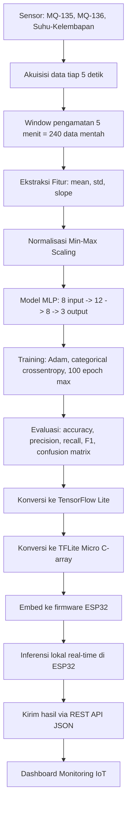

# Machine Learning Pipeline — SIGAP MBG (Smart MBG Lid)

Dokumen ini adalah spesifikasi teknis lengkap untuk bagian Machine Learning dari sistem SIGAP MBG, disusun dari proposal PKM-KC yang sudah lolos pendanaan. Tujuannya: jadi acuan langsung buat nulis kode, bukan cuma dokumen administratif.

---

## 1. Ringkasan Proyek

SIGAP MBG adalah modul sensor pintar yang dipasang di tutup ompreng MBG, mendeteksi kondisi kesegaran makanan secara real-time selama distribusi, lalu mengirim hasil klasifikasi ke dashboard monitoring berbasis IoT.

Hardware: ESP32 (mikrokontroler), MQ-135 (deteksi amonia/NH₃ dan polutan lain), MQ-136 (deteksi H₂S), sensor suhu-kelembapan (SHT31 — lihat catatan di bagian 15 soal inkonsistensi penamaan di proposal), powerbank, modul komunikasi nirkabel bawaan ESP32.

## 2. Tujuan Machine Learning

Model ML di sini punya satu tugas spesifik: **mengklasifikasikan kondisi makanan ke dalam 3 kelas** berdasarkan pola sinyal sensor gas dan lingkungan, yaitu:

1. **Layak** — aman dikonsumsi
2. **Perlu Diperiksa** — mulai menunjukkan indikasi penurunan mutu, butuh verifikasi manual
3. **Tidak Layak** — tidak aman dikonsumsi

Model ini harus ringan cukup untuk jalan secara lokal di ESP32 (edge inference, bukan cloud), karena sistem harus tetap berfungsi meski koneksi internet terbatas dan supaya konsumsi daya rendah untuk operasi berbasis baterai/powerbank.

## 3. Teknik Machine Learning yang Digunakan

| Aspek | Teknik | Alasan |
|---|---|---|
| Model | Multi Layer Perceptron (MLP) | Ringan, cocok untuk input tabular berukuran kecil (8 fitur), bisa dikompres jadi TinyML |
| Framework training | TensorFlow / Keras | Punya jalur konversi resmi ke TensorFlow Lite dan TFLite Micro |
| Deployment | TinyML via TensorFlow Lite Micro | Supaya inferensi jalan langsung di ESP32 tanpa komputer/cloud tambahan |
| Ekstraksi fitur | Statistik deskriptif (mean, std, slope) per window waktu | Mengubah data time-series mentah jadi representasi ringkas yang bisa dipakai MLP |
| Normalisasi | Min-Max Scaling | Standar untuk data sensor dengan rentang nilai berbeda-beda antar sensor |
| Fungsi aktivasi | ReLU (hidden layer), Softmax (output layer) | ReLU untuk non-linearitas + efisiensi komputasi, Softmax karena ini klasifikasi multi-kelas |
| Optimizer | Adam (lr = 0.001) | Konvergensi stabil untuk dataset kecil-menengah |
| Loss function | Categorical Crossentropy | Standar untuk klasifikasi multi-kelas dengan output softmax |
| Evaluasi | Accuracy, Precision, Recall, F1-score, Confusion Matrix | Supaya kesalahan klasifikasi per kelas kelihatan jelas — penting karena kelas "Perlu Diperiksa" dan "Tidak Layak" punya konsekuensi keamanan pangan berbeda |

## 4. Alur End-to-End (Pipeline)



Ada dua fase besar yang harus dipisah jelas di kode: **fase offline (training di komputer)** dan **fase online (inferensi di ESP32)**. Jangan campur logic keduanya dalam satu file/modul.

## 5. Spesifikasi Sensor & Data Mentah

- **Akuisisi**: setiap 5 detik
- **Window pengamatan**: 5 menit → 300 detik / 5 detik = **240 data mentah per window per sensor**
- Sensor yang dibaca tiap siklus: MQ-135 (raw ADC/ppm), MQ-136 (raw ADC/ppm), suhu (°C), kelembapan (%RH)

Data mentah ini **wajib disimpan utuh** (bukan cuma fitur hasil ekstraksi) selama fase pengumpulan dataset, supaya kalau nanti mau ganti metode ekstraksi fitur, tidak perlu ulang eksperimen fisik dari nol.

## 6. Ekstraksi Fitur

Dari 240 data mentah per window, diekstrak jadi **8 fitur**:

| # | Fitur | Sumber | Formula |
|---|---|---|---|
| 1 | `mq135_mean` | MQ-135 | rata-rata 240 pembacaan |
| 2 | `mq135_std` | MQ-135 | standar deviasi 240 pembacaan |
| 3 | `mq135_slope` | MQ-135 | kemiringan garis regresi linear (least squares) terhadap waktu dalam window |
| 4 | `mq136_mean` | MQ-136 | rata-rata 240 pembacaan |
| 5 | `mq136_std` | MQ-136 | standar deviasi 240 pembacaan |
| 6 | `mq136_slope` | MQ-136 | kemiringan garis regresi linear terhadap waktu dalam window |
| 7 | `temp_mean` | Suhu | rata-rata 240 pembacaan |
| 8 | `humidity_mean` | Kelembapan | rata-rata 240 pembacaan |

**Catatan implementasi slope**: pakai regresi linear sederhana (`numpy.polyfit(x, y, 1)[0]` di Python, atau hitung manual least-squares di firmware C++ kalau slope juga mau dihitung on-device). Slope penting karena ini yang menangkap *tren kenaikan* konsentrasi gas — indikator pembusukan yang lebih kuat dibanding nilai rata-rata saja.

## 7. Preprocessing / Normalisasi

- Metode: **Min-Max Scaling** ke rentang [0, 1]
- **Penting**: parameter min-max (hasil `fit` di data training) harus disimpan (misal `scaler_params.json`) dan dipakai ulang persis sama saat inferensi di ESP32. Jangan hitung ulang min-max di device — itu akan merusak konsistensi skala antara training dan inference.
- Firmware ESP32 perlu implementasi normalisasi manual pakai nilai min-max yang sudah di-hardcode dari hasil training (karena tidak pakai library scikit-learn di C++).

## 8. Arsitektur Model (MLP)

```
Input Layer     : 8 neuron (8 fitur)
Hidden Layer 1  : 12 neuron, aktivasi ReLU
Hidden Layer 2  : 8 neuron, aktivasi ReLU
Output Layer    : 3 neuron, aktivasi Softmax (Layak / Perlu Diperiksa / Tidak Layak)
```

Contoh definisi model (Keras):

```python
from tensorflow import keras
from tensorflow.keras import layers

model = keras.Sequential([
    layers.Input(shape=(8,)),
    layers.Dense(12, activation='relu'),
    layers.Dense(8, activation='relu'),
    layers.Dense(3, activation='softmax')
])

model.compile(
    optimizer=keras.optimizers.Adam(learning_rate=0.001),
    loss='categorical_crossentropy',
    metrics=['accuracy']
)
```

## 9. Setup Training

- **Split**: 80% training, 20% testing — pakai **stratified split** (`train_test_split(..., stratify=y)`) supaya proporsi 3 kelas tetap seimbang di kedua set, bukan split acak biasa.
- **Batch size**: 16
- **Epoch**: maksimum 100, tapi **tambahkan EarlyStopping** (monitor `val_loss`, patience 10–15) karena dataset kemungkinan besar kecil dan model gampang overfit tanpa itu.
- **Label encoding**: one-hot encoding untuk 3 kelas (`keras.utils.to_categorical`).
- Kalau dataset akhirnya tetap kecil (di bawah ~200 sampel), pertimbangkan **k-fold cross-validation** di fase evaluasi awal untuk dapat estimasi performa yang lebih jujur, sebelum commit ke satu split 80/20 final.

## 10. Evaluasi Model

Metrik wajib: **accuracy, precision, recall, F1-score per kelas, dan confusion matrix**. Precision/recall per kelas penting di sini — akurasi keseluruhan bisa terlihat tinggi padahal model gagal total mendeteksi kelas "Tidak Layak" (yang justru paling kritis dari sisi keamanan pangan). Selalu cek recall kelas "Tidak Layak" secara terpisah.

```python
from sklearn.metrics import classification_report, confusion_matrix

y_pred = model.predict(X_test)
y_pred_classes = y_pred.argmax(axis=1)
y_true_classes = y_test.argmax(axis=1)

print(classification_report(y_true_classes, y_pred_classes,
      target_names=['Layak', 'Perlu Diperiksa', 'Tidak Layak']))
print(confusion_matrix(y_true_classes, y_pred_classes))
```

## 11. Konversi & Deployment (TFLite → TFLite Micro → ESP32)

Langkah konversi:

```python
converter = tf.lite.TFLiteConverter.from_keras_model(model)
converter.optimizations = [tf.lite.Optimize.DEFAULT]  # quantization untuk ukuran lebih kecil
tflite_model = converter.convert()

with open('sigap_mbg_mlp.tflite', 'wb') as f:
    f.write(tflite_model)
```

Lalu convert `.tflite` jadi C header array (bisa pakai `xxd -i` atau tool `tflite2c`) supaya bisa di-embed ke firmware:

```bash
xxd -i sigap_mbg_mlp.tflite > model_data.h
```

Di firmware ESP32 (Arduino/PlatformIO + library `TensorFlowLite_ESP32` atau `Chirale_TensorFlowLite`):
1. Load model dari `model_data.h`
2. Baca sensor, kumpulkan 240 data selama 5 menit
3. Hitung 8 fitur (mean/std/slope) langsung di device
4. Normalisasi pakai min-max yang sudah di-hardcode dari hasil training
5. Jalankan inferensi (`interpreter->Invoke()`)
6. Ambil kelas dengan probabilitas softmax tertinggi (`argmax`)
7. Nyalakan LED indikator sesuai hasil, kirim JSON ke server

## 12. Format Output & Integrasi IoT

Payload JSON yang dikirim ESP32 ke server via REST API (POST):

```json
{
  "device_id": "SIGAP-MBG-01",
  "timestamp": "2026-09-18T10:15:00Z",
  "mq135_mean": 245.3,
  "mq135_std": 12.1,
  "mq135_slope": 0.85,
  "mq136_mean": 18.7,
  "mq136_std": 2.3,
  "mq136_slope": 0.12,
  "temp_mean": 29.4,
  "humidity_mean": 68.2,
  "prediction": "Perlu Diperiksa",
  "confidence": 0.87
}
```

Server (REST API + MySQL, sesuai proposal) menyimpan payload ini dan menampilkannya di dashboard monitoring.

## 13. Protokol Pengumpulan Dataset & Labeling

Ini bagian paling kritis dan **belum didefinisikan jelas di proposal** — harus diputuskan sebelum mulai koleksi data:

1. **Skala dataset tidak realistis kalau cuma "9 sampel x 3 variasi"** — kalau itu artinya cuma 27 window/titik data, itu terlalu sedikit untuk melatih model 3 kelas yang bisa generalize. Rekomendasi: tiap sampel fisik (9 sampel karbohidrat/protein/buah) dipantau **kontinu** dari kondisi segar sampai busuk (misal tiap 1–2 jam), dan tiap titik waktu itu menghasilkan satu window 5 menit → satu baris fitur. Ini bisa menghasilkan puluhan hingga ratusan baris data per sampel, bukan cuma 1.
2. **Kriteria labeling harus eksplisit dan konsisten**, bukan sekadar "kelihatan busuk". Rekomendasi: tetapkan ambang waktu/kondisi objektif per kategori makanan (misal berdasarkan lama penyimpanan pada suhu ruang + verifikasi sensorik oleh 2+ orang secara independen), dicatat di log terpisah dari data sensor.
3. **Jaga keseimbangan kelas** — pastikan jumlah window per kelas (Layak/Perlu Diperiksa/Tidak Layak) tidak timpang jauh, karena distribusi tidak seimbang akan bikin model bias ke kelas mayoritas.
4. Simpan setiap window mentah dengan metadata: jenis sampel, waktu pengambilan, label ground truth, kondisi lingkungan saat pengambilan (kalau eksperimen dilakukan di waktu/tempat berbeda-beda).

## 14. Struktur Folder Proyek (untuk Implementasi Kode)

```
sigap-mbg-ml/
├── data/
│   ├── raw/                     # log time-series mentah per sesi/sampel (CSV)
│   └── processed/                # dataset hasil ekstraksi fitur (feature_dataset.csv)
├── notebooks/
│   └── eda_dan_training.ipynb    # eksplorasi data + eksperimen training
├── src/
│   ├── data_collection/
│   │   └── serial_logger.py      # baca data dari ESP32 (serial/WiFi), simpan ke CSV
│   ├── feature_extraction/
│   │   └── extract_features.py   # fungsi windowing + mean/std/slope
│   ├── preprocessing/
│   │   └── normalize.py          # fit & simpan Min-Max scaler
│   ├── model/
│   │   ├── train.py              # bangun & latih MLP
│   │   ├── evaluate.py           # metrics + confusion matrix
│   │   └── convert_tflite.py     # convert .h5 -> .tflite -> C array
│   └── utils/
├── firmware/
│   └── esp32/
│       ├── model_data.h          # hasil convert TFLite ke C array
│       ├── main.cpp              # baca sensor, ekstrak fitur, inferensi, kirim JSON
│       └── platformio.ini
├── models/
│   ├── sigap_mbg_mlp.h5
│   ├── sigap_mbg_mlp.tflite
│   └── scaler_params.json        # min-max per fitur, dipakai ulang di firmware
└── requirements.txt
```

## 15. Risiko & Hal yang Perlu Diperhatikan

- **Inkonsistensi sensor di proposal**: bagian 2.5 dan 3.3 menyebut SHT21, tapi bagian 3.1 (Alat dan Bahan) dan 3.6 (Implementasi) menyebut SHT31. Dokumen ini mengasumsikan **SHT31** karena itu yang muncul di bagian teknis paling konkret, tapi ini harus dikonfirmasi ke tim (Kak Fionita/Rafi) supaya proposal dan implementasi konsisten sebelum sempro.
- **Ukuran dataset** adalah risiko terbesar untuk kualitas model — lihat bagian 13.
- **Slope pada gas sensor MOS (MQ-135/MQ-136) butuh waktu pemanasan (burn-in)** sebelum pembacaan stabil — pastikan window pengukuran tidak dimulai tepat setelah sensor baru dinyalakan, atau slope awal akan salah menangkap "tren stabilisasi sensor" sebagai "tren pembusukan".
- **Kuantisasi model** (`tf.lite.Optimize.DEFAULT`) penting supaya file model cukup kecil untuk RAM/flash ESP32 — cek ukuran `.tflite` setelah konversi, dan uji ulang akurasi setelah kuantisasi (bisa turun sedikit).
- Kode inferensi di firmware (`main.cpp`) dan kode preprocessing di Python (`extract_features.py`, `normalize.py`) **harus menghasilkan angka fitur yang identik** untuk input yang sama — kalau beda, model akan salah prediksi di device meski akurat saat training.

## 16. Checklist Implementasi Bertahap

- [ ] Konfirmasi sensor suhu-kelembapan final (SHT21 atau SHT31) ke tim
- [ ] Tetapkan protokol labeling (kriteria objektif per kelas)
- [ ] Bangun `serial_logger.py` untuk kumpulkan data mentah dari ESP32 ke CSV
- [ ] Kumpulkan data mentah secara kontinu per sampel (bukan snapshot tunggal)
- [ ] Bangun `extract_features.py` (windowing 5 menit, hitung 8 fitur)
- [ ] Bangun dataset fitur final, cek distribusi kelas
- [ ] Fit Min-Max scaler, simpan parameter
- [ ] Bangun & latih MLP (`train.py`), evaluasi dengan classification report + confusion matrix
- [ ] Kalau performa oke, convert ke `.tflite` lalu ke C array
- [ ] Implementasi firmware ESP32: baca sensor → ekstrak fitur → normalisasi → inferensi → kirim JSON
- [ ] Uji end-to-end: sensor fisik → prediksi ESP32 → dashboard
