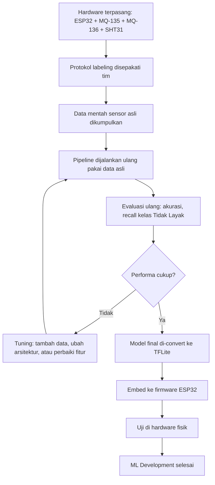

# Status & Langkah Selanjutnya — Machine Learning SIGAP MBG

Dokumen ini pelengkap dari `ML_Pipeline_SIGAP_MBG.md`. Kalau dokumen itu berisi spesifikasi teknis pipeline, dokumen ini berisi **di titik mana progres sekarang berada** dan **apa saja yang masih harus terjadi** sebelum bagian ML bisa disebut selesai beneran. Tujuannya biar nggak ada kesalahpahaman ke tim atau dosen pembimbing soal status "selesai".

---

## 1. Status Saat Ini (per hari ini)

Pipeline kode Machine Learning **sudah dibangun dan tervalidasi jalan end-to-end**, tapi validasinya pakai **data sintetis/dummy**, bukan data sensor asli. Rinciannya:

| Komponen | Status | Catatan |
|---|---|---|
| Struktur folder proyek | Selesai | Sesuai spesifikasi di `ML_Pipeline_SIGAP_MBG.md` bagian 14 |
| Generator data dummy | Selesai | 72.000 baris data sensor sintetis (300 window × 240 titik) |
| Ekstraksi fitur | Selesai & teruji | 8 fitur per window, jalan tanpa error |
| Normalisasi (Min-Max) | Selesai & teruji | Parameter scaler tersimpan di JSON |
| Training model MLP | Selesai & teruji | Arsitektur 8→12→8→3 sesuai spek, 239 parameter |
| Evaluasi model | Selesai (pakai dummy) | Akurasi 100% di data dummy — **ini bukan indikator performa asli**, lihat bagian 3 |
| Konversi ke TFLite + C header | Selesai | File siap embed, belum pernah diuji di hardware fisik |
| Firmware ESP32 (integrasi model) | **Belum dimulai** | Menunggu hardware dan model final dari data asli |
| Data sensor asli dari tim | **Belum ada** | Blocker utama, lihat bagian 4 |

## 2. Yang Perlu Dipahami Soal Angka Akurasi 100%

Model dapat akurasi 100% karena data dummy yang dipakai untuk uji pipeline dibuat dengan rentang nilai yang sengaja mudah dipisahkan antar 3 kelas. Itu bukan bukti model bagus — itu bukti **kode pipeline-nya nggak error**. Begitu data asli masuk (yang pasti lebih noisy, ada overlap antar kelas, dan dipengaruhi variabel dunia nyata seperti suhu ruangan saat pengambilan data), akurasi hampir pasti turun dari 100%. Ini normal dan wajib diantisipasi, bukan tanda ada yang salah di kode.

## 3. Blocker Utama: Data Sensor Asli

Ini satu-satunya hal yang benar-benar menahan progres ke tahap final. Status terakhir yang diketahui:

- Code sensor dari Rafi masih belum terhubung dengan logic AI
- Tim masih mencari cara menyambungkan data dari unit sensor (ompreng) ke dashboard IoT
- Protokol pengumpulan dataset (berapa lama tiap sampel dipantau, kapan dianggap "Perlu Diperiksa" vs "Tidak Layak") belum disepakati tim secara eksplisit — lihat catatan di `ML_Pipeline_SIGAP_MBG.md` bagian 13

Tanpa tiga hal ini selesai di sisi hardware/tim, bagian ML nggak bisa maju ke tahap final — mau secanggih apa pun pipeline kodenya.

## 4. Dependency Chain (Urutan yang Harus Terjadi)

Poin penting: **kode yang sudah ada sekarang nggak perlu ditulis ulang** di langkah D — cukup ganti file input dari dummy ke `data/raw/real_sensor_data.csv` dan jalankan ulang urutan script yang sama.

## 5. Kriteria "Selesai" yang Sebenarnya

Bagian ML baru bisa disebut selesai kalau semua ini terpenuhi:

- [ ] Data sensor asli terkumpul dari minimal 9 sampel fisik, dengan label yang konsisten dan kriteria jelas
- [ ] Pipeline dijalankan ulang pakai data asli (bukan dummy)
- [ ] Evaluasi ulang menunjukkan performa yang masuk akal secara realistis (bukan 100%) — terutama recall kelas "Tidak Layak" harus tinggi, karena ini yang paling kritis dari sisi keamanan pangan
- [ ] Model final (bukan hasil training dummy) dikonversi ke TFLite dan di-embed ke firmware ESP32
- [ ] Diuji di hardware fisik: sensor asli → inferensi di ESP32 → hasil klasifikasi cocok dengan kondisi makanan sebenarnya

## 6. Langkah Konkret Selanjutnya

**Yang jadi tanggung jawab tim (hardware/data):**
1. Selesaikan perakitan sensor (ESP32 + MQ-135 + MQ-136 + SHT31) di unit fisik
2. Sepakati protokol labeling sebelum mulai ambil data (lihat `ML_Pipeline_SIGAP_MBG.md` bagian 13)
3. Kumpulkan data mentah secara kontinu per sampel — bukan snapshot tunggal per sampel

**Yang bisa dikerjakan sekarang tanpa nunggu data asli:**
1. Bantu selesaikan integrasi logic AI ke code sensor Rafi (sesuai rencana yang sudah disebut sebelumnya)
2. Siapkan skrip/endpoint yang bakal terima data mentah dari ESP32 begitu hardware siap (bisa disambungkan ke backend dashboard yang sudah dispesifikasikan di `Web_Dashboard_SIGAP_MBG.md`)
3. Review ulang apakah generator data dummy bisa dibuat lebih realistis (nambah noise/overlap antar kelas), supaya pengujian pipeline sebelum data asli datang lebih mendekati kondisi nyata — ini opsional, tapi berguna buat deteksi bug lebih awal

**Setelah data asli tersedia:**
1. Jalankan ulang pipeline dengan data asli
2. Evaluasi ulang, cek recall kelas "Tidak Layak" secara khusus
3. Kalau performa kurang, iterasi: tambah data, sesuaikan fitur, atau perbesar arsitektur MLP
4. Kalau performa cukup, lanjut ke integrasi firmware ESP32 dan uji hardware fisik

## 7. Jangan Laporkan Sebagai "Selesai" Sampai...

Untuk komunikasi ke Kak Fionita atau dosen pembimbing: status yang akurat sekarang adalah **"pipeline ML siap dan tervalidasi secara teknis, menunggu data sensor asli dari tim untuk training final"** — bukan "ML sudah selesai". Ini penting terutama menjelang PKP2, karena evaluator kemungkinan besar akan tanya soal data asli dan performa nyata, bukan cuma soal kode.
