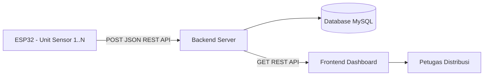
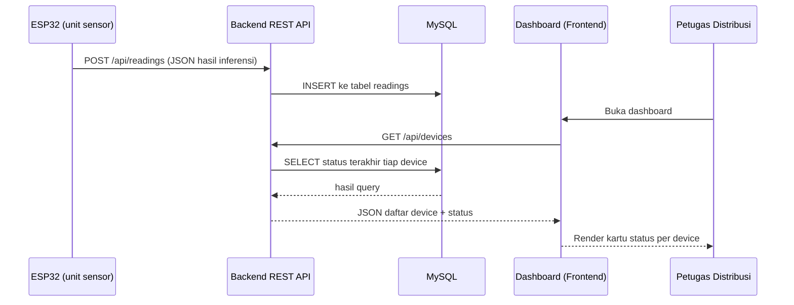

# Web Dashboard Monitoring — SIGAP MBG

Dokumen ini spesifikasi teknis untuk bagian web dashboard SIGAP MBG. Sudah di-cross-check dengan proposal PKM-KC — bagian ini memang minim detail di proposal aslinya, jadi sebagian besar desain di bawah adalah keputusan implementasi yang perlu diverifikasi ke tim (terutama Kak Fionita) sebelum dieksekusi penuh.

---

## 1. Cross-check dengan Proposal

Yang eksplisit disebut proposal soal bagian ini:

- ESP32 mengirim hasil klasifikasi ke server dalam **format JSON via REST API**
- Data disimpan ke **basis data (MySQL, disebut di Alat & Bahan 3.1)**
- Fungsi dashboard: petugas distribusi bisa **memantau kondisi makanan secara langsung** selama distribusi MBG
- Data harus bisa diakses **terpusat dari setiap titik distribusi** (Bab 2.8) — mengindikasikan sistem harus mendukung **banyak device/lokasi**, bukan satu alat saja
- Indikator keberhasilan luaran #3: "data sensor dapat ditampilkan pada dashboard atau aplikasi" — tidak ada spesifikasi fitur lebih lanjut

**Yang tidak didefinisikan proposal (jadi keputusan desain di bawah):** jumlah halaman, jenis visualisasi, ada tidaknya sistem login, granularitas alert, dan platform (web vs aplikasi mobile — dokumen ini asumsi web, sesuai jobdesk "web dev").

## 2. Tujuan Dashboard

Menyediakan satu titik akses terpusat bagi petugas distribusi MBG untuk memantau status kesegaran makanan real-time dari seluruh unit SIGAP MBG yang terpasang di berbagai titik distribusi, berdasarkan hasil klasifikasi dari model ML yang berjalan di tiap ESP32.

## 3. Arsitektur Sistem



Backend menerima data dari banyak ESP32 (satu per unit ompreng/titik distribusi), menyimpannya, dan menyediakan endpoint terpisah untuk frontend dashboard menariknya kembali.

## 4. Tech Stack yang Direkomendasikan

| Layer | Pilihan | Alasan |
|---|---|---|
| Backend | Node.js + Express | Sesuai stack yang sudah pernah lo pakai (BarberSync), cepat buat REST API sederhana |
| Database | MySQL | Sesuai yang disebut proposal |
| Frontend | EJS (server-rendered) + Chart.js | Simpel, cepat dibangun, cukup buat MVP kompetisi; Chart.js buat grafik tren sensor |
| Realtime update | Polling interval (5–10 detik) di awal; upgrade ke Socket.io kalau sempat | Polling cukup untuk skala PKM, tidak butuh infrastruktur tambahan |
| Hosting | Free tier (Railway/Render) atau server kampus | Budget proyek kecil (~2,3 juta), hindari biaya hosting berbayar |

Kalau lo lebih nyaman pakai stack lain (misal Next.js atau langsung React), strukturnya di dokumen ini tetap berlaku — cuma folder frontend yang beda.

## 5. Skema Database

```sql
CREATE TABLE devices (
    id INT AUTO_INCREMENT PRIMARY KEY,
    device_id VARCHAR(50) UNIQUE NOT NULL,   -- contoh: "SIGAP-MBG-01"
    location_name VARCHAR(150),               -- nama SPPG / titik distribusi
    created_at TIMESTAMP DEFAULT CURRENT_TIMESTAMP
);

CREATE TABLE readings (
    id INT AUTO_INCREMENT PRIMARY KEY,
    device_id VARCHAR(50) NOT NULL,
    reading_timestamp DATETIME NOT NULL,
    mq135_mean FLOAT, mq135_std FLOAT, mq135_slope FLOAT,
    mq136_mean FLOAT, mq136_std FLOAT, mq136_slope FLOAT,
    temp_mean FLOAT, humidity_mean FLOAT,
    prediction ENUM('Layak', 'Perlu Diperiksa', 'Tidak Layak') NOT NULL,
    confidence FLOAT,
    created_at TIMESTAMP DEFAULT CURRENT_TIMESTAMP,
    FOREIGN KEY (device_id) REFERENCES devices(device_id)
);

-- Opsional, kalau mau ada login petugas distribusi
CREATE TABLE users (
    id INT AUTO_INCREMENT PRIMARY KEY,
    username VARCHAR(50) UNIQUE NOT NULL,
    password_hash VARCHAR(255) NOT NULL,
    role VARCHAR(20) DEFAULT 'petugas',
    created_at TIMESTAMP DEFAULT CURRENT_TIMESTAMP
);
```

Kolom `readings` sengaja dibuat identik dengan payload JSON yang sudah didefinisikan di dokumen ML pipeline (`ML_Pipeline_SIGAP_MBG.md`, bagian 12) — supaya endpoint penerima data tinggal insert langsung tanpa mapping ulang field.

## 6. Spesifikasi REST API

| Method | Endpoint | Fungsi | Konsumen |
|---|---|---|---|
| POST | `/api/readings` | Terima payload JSON dari ESP32, insert ke tabel `readings`, auto-create device kalau `device_id` belum terdaftar | ESP32 (firmware) |
| GET | `/api/devices` | List semua device + status/prediksi terakhir masing-masing | Dashboard (halaman overview) |
| GET | `/api/devices/:device_id/latest` | Status & pembacaan sensor terbaru satu device | Dashboard (kartu status) |
| GET | `/api/devices/:device_id/readings?limit=100` | Riwayat pembacaan satu device, buat grafik tren | Dashboard (halaman detail) |
| GET | `/api/alerts?status=Tidak%20Layak&since=...` | List reading dengan status kritis dalam rentang waktu tertentu | Dashboard (halaman alert) |

Contoh body request `POST /api/readings` (identik dengan dokumen ML section 12):

```json
{
  "device_id": "SIGAP-MBG-01",
  "timestamp": "2026-09-19T10:15:00Z",
  "mq135_mean": 245.3, "mq135_std": 12.1, "mq135_slope": 0.85,
  "mq136_mean": 18.7, "mq136_std": 2.3, "mq136_slope": 0.12,
  "temp_mean": 29.4, "humidity_mean": 68.2,
  "prediction": "Perlu Diperiksa",
  "confidence": 0.87
}
```

## 7. Halaman & Fitur Dashboard

1. **Overview (Home)** — grid/list semua device aktif, tiap kartu menampilkan `device_id`, lokasi, status terkini dengan badge warna (hijau = Layak, kuning = Perlu Diperiksa, merah = Tidak Layak), dan waktu update terakhir.
2. **Detail Device** — grafik garis (Chart.js) untuk tren `mq135_mean`, `mq136_mean`, suhu, kelembapan dari waktu ke waktu, plus tabel riwayat klasifikasi device tersebut.
3. **Halaman Alert** — daftar semua kejadian status "Perlu Diperiksa" dan "Tidak Layak" terbaru lintas device, diurutkan dari yang paling baru — ini yang paling relevan buat petugas distribusi yang butuh respons cepat.
4. **(Opsional) Manajemen Device** — tambah/edit nama & lokasi device baru saat unit SIGAP MBG baru dipasang di titik distribusi lain.
5. **(Opsional) Login** — kalau dashboard perlu dibatasi hanya untuk petugas MBG, bukan publik.

## 8. Alur Data End-to-End



## 9. Struktur Folder Proyek

```
sigap-mbg-dashboard/
├── backend/
│   ├── src/
│   │   ├── routes/
│   │   │   ├── readings.js       # POST /api/readings, GET riwayat
│   │   │   ├── devices.js        # GET /api/devices, /latest
│   │   │   └── alerts.js         # GET /api/alerts
│   │   ├── models/
│   │   │   ├── device.js
│   │   │   └── reading.js
│   │   ├── db/
│   │   │   └── connection.js     # koneksi MySQL (mysql2/promise)
│   │   └── app.js                # setup Express app
│   ├── migrations/
│   │   └── init.sql              # schema dari bagian 5
│   └── package.json
├── frontend/
│   ├── views/                    # EJS templates
│   │   ├── overview.ejs
│   │   ├── device-detail.ejs
│   │   └── alerts.ejs
│   └── public/
│       ├── css/
│       └── js/
│           └── chart-config.js   # setup Chart.js
└── README.md
```

## 10. Risiko & Catatan

- **Skala device belum jelas dari proposal** — kalau ternyata cuma 1 unit prototipe yang dipakai untuk demo/sempro (bukan multi-lokasi beneran), tabel `devices` tetap aman dipakai karena mendukung 1 atau banyak device tanpa perubahan skema.
- **Validasi payload dari ESP32 wajib ada di endpoint POST** — kalau firmware kirim field yang salah tipe atau field yang hilang (misal `confidence` kosong), endpoint harus reject dengan pesan jelas, bukan diam-diam gagal insert.
- **Auto-create device saat `device_id` baru muncul** itu pilihan desain, bukan keharusan — kalau tim mau kontrol lebih ketat (device harus didaftarkan manual dulu sebelum bisa kirim data), ganti jadi reject request dari device_id yang belum terdaftar.
- Karena budget PKM kecil, hindari servis berbayar (jangan pakai managed database mahal) — MySQL lokal atau free tier cukup untuk kebutuhan demo dan sempro.

## 11. Checklist Implementasi

- [ ] Setup project Express + koneksi MySQL, jalankan `init.sql`
- [ ] Implementasi `POST /api/readings` + validasi payload
- [ ] Implementasi `GET /api/devices` dan `/latest`
- [ ] Implementasi `GET /api/devices/:device_id/readings` (buat grafik)
- [ ] Implementasi `GET /api/alerts`
- [ ] Bangun halaman Overview (kartu status per device)
- [ ] Bangun halaman Detail Device (grafik + tabel riwayat)
- [ ] Bangun halaman Alert
- [ ] Uji end-to-end: kirim data dummy via `curl`/Postman ke `/api/readings`, cek muncul di dashboard
- [ ] Setelah firmware ESP32 (dari dokumen ML) siap kirim data asli, uji ulang end-to-end dengan device fisik
